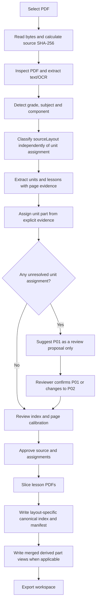

# Book Indexing and Workspace Preparation Algorithm

## 1. Responsibility boundary

This document defines the indexing workflow owned and executed by ai_books. The application owns PDF discovery, curriculum identity, source-layout classification, unit-part assignment, index review, page calibration, lesson slicing, file paths, manifests and hashes.

The application is both the indexing producer and the workspace consumer. Its student-side import path must not duplicate the PDF classifier, infer part assignments, rebuild lesson paths when sliceFile.workspaceUri exists, or slice the source PDF again.

The Kotlin/Android implementation is the authority for actual behavior. Where this document describes target behavior not yet implemented, the status is explicitly marked below.

## 2. End-to-end preparation sequence



A proposal must never be silently converted into a confirmed assignment. The approval gate must reject unresolved units.

## 3. Source layout and unit assignment are separate

### 3.1 `sourceLayout`

- `SINGLE_PART_FILE`: the uploaded PDF is confirmed to contain one part only; a P01/P02 cover label by itself is not sufficient evidence.
- `MERGED_PARTS_FILE`: the uploaded PDF is one source containing both parts.
- Unknown or conflicting evidence remains under review; it must not be converted to a single-part source merely because the TOC is unclear.

### 3.2 Unit assignment

For each unit, preserve:
- confirmed `partKey` or `unknown`;
- `assignmentStatus`;
- optional `proposedPartKey`;
- `assignmentEvidence`;
- `assignmentSource`: `INDEX_EVIDENCE`, `REVIEWER`, `DEFAULT_PROPOSAL`, or `LEGACY_UNVERIFIED`.

Automatic assignment requires explicit source evidence such as a TOC section, unit title/heading evidence or a verified standalone-source part. Unit number alone is never evidence.

For an unresolved unit in a confirmed merged source, the app-owned intake workflow may propose P01 as a default review suggestion. The UI must display the proposal and require an explicit reviewer action to confirm P01 or choose P02. Until that action, keep `partKey=unknown`, `assignmentStatus=need_review`, and keep the source `sourceLayout=MERGED_PARTS_FILE`.

A manual decision must be recorded as reviewer provenance. A confirmed proposal must not be recorded as automatic evidence.

## 4. Workspace layout

### 4.1 Independent single-part PDF — target layout

For a P01 source:

```text
workspace/<gradeKey>/<subjectKey>[/<componentKey>]/
  P01/
    index.json
    book_manifest.json
    cover.png
    units/<unit-folder>/lesson_<nn>.pdf
```

For P02, use the P02 directory. No root `index.json` is written for an independent source. The part-local manifest carries that source's `sourceSha256` and canonical index path/hash.

### 4.2 One merged PDF — target layout

```text
workspace/<gradeKey>/<subjectKey>[/<componentKey>]/
  index.json
  book_manifest.json
  cover.png
  P01/
    index.json
    cover.png
    units/...
  P02/
    index.json
    cover.png
    units/...
```

The root index is the one canonical complete index. Part indexes are derived filtered views. They retain the merged source identity and must never be treated as independent books.

### 4.3 Merged source requiring assignment review

Keep `sourceLayout=MERGED_PARTS_FILE`. The unresolved intake draft remains in the review state; do not export a final workspace, root manifest, derived part indexes, or lesson slices until all required assignments are explicitly confirmed. After confirmation, export one root canonical index and its derived part views.

## 5. Canonical identity and display values

Use `gradeKey`, `subjectKey`, and optional `componentKey` as stable identity. The Arabic display names in the prepared index (`displayName`, `subjectName`, and `componentName`, when provided) are the preferred labels for UI presentation. Consumers may use a local catalog only as a fallback. Never derive a canonical key from a display name.

## 6. Lesson file references

Each sliced lesson must carry a workspace-relative `sliceFile.workspaceUri` that resolves to the exact generated PDF. This path is authoritative for consumers. Paths must be normalized and constrained to the workspace root.

Consumers should use that explicit reference directly. Reconstructing `P01/units/unit_01/lesson_01.pdf` from numbers is only a legacy fallback for old packages with no explicit path.

## 7. Manifest and hashes

The canonical app-owned manifest writer must write `edu.book_manifest.v2` with:
- `canonicalIndexPath` and `canonicalIndexSha256` for the canonical index;
- `indexSha256` as a compatibility alias for that canonical hash;
- `partIndexes` containing each derived part path and its independent SHA-256;
- `sourceSha256`, `sourceLayout`, `sourceReviewStatus`, identity keys, cover paths and export counts.

For a standalone source, the canonical index is `P01/index.json` or `P02/index.json` and its manifest is beside it. For a merged source, the canonical index is root `index.json` and derived part views are inside P01/P02. Hashes are calculated from the exact serialized bytes written to each file.

## 8. Current implementation status

The Kotlin/Android repository now contains the following app-owned foundations:

- PDF intake in PdfBookSplitter records the source filename, SHA-256 and physical page count.
- The current fixed-page splitter output is explicitly marked as a provisional draft (edu.book_index.draft.v1 / edu.book_manifest.draft.v1), not as a canonical v2 index or verified source.
- The splitter no longer assigns P01 unconditionally to every LessonRef; an unknown part remains unknown.
- BookIndexIntakeWorkflow.kt defines the shared review contract for grade/subject names and keys, source layout/part, book title, template selection, discovery method, offset, unit/lesson metadata, printed and physical PDF pages, assignment provenance and reviewer confirmation.
- The shared validator blocks approval while source layout, unit-part assignment, page ranges or reviewer confirmation remain unresolved.
- A dedicated reusable AI discovery prompt exists at app/src/main/assets/prompts/book_indexing/book_index_discovery.prompt.md.
- Existing reusable lesson-generation prompt resources were moved under prompts/book_indexing, and the registry now uses app-owned BookIndexPromptRegistry / BookIndexSchemaSpec naming.
- The registry's canonical index example now declares edu.book_index.v2 and includes grade/subject display metadata, offset, source layout, assignment evidence and separate printed/physical page fields. The book manifest example describes edu.book_manifest.v2.

The following end-to-end pieces are not yet implemented or verified and must not be described as completed:

- The book upload UI is not yet wired to BookIndexIntakeWorkflow. The existing PDF splitter dialog is not the complete metadata-review experience.
- Automatic extraction of grade, subject, table of contents, unit/lesson titles and page evidence is not yet connected to the intake screen.
- The dedicated discovery prompt is not yet invoked with selected PDF pages through the AI provider pipeline.
- Built-in deterministic TOC parsing and AI-assisted extraction are not yet selectable from one integrated intake screen.
- The approved intake model is not yet the sole input to the canonical v2 index serializer, manifest writer and final slicer.
- No end-to-end Android build, instrumented test, or full upload → discover → edit → confirm → approve → slice test was run during this change.

Therefore, the data contract and architectural ownership are now established, but the complete interactive discovery workflow remains the next implementation milestone.

## 9. Consumer requirements for Edu Mini

Edu Mini must:
1. discover root and part-local index files;
2. pair each canonical index with the manifest beside it;
3. classify a part-local standalone index separately from a merged derived view;
4. bind a merged root index exactly once and not create duplicate books from its derived indexes;
5. verify every declared hash against its own file;
6. use index-provided display labels when present, with local catalog fallback;
7. resolve lessons from `sliceFile.workspaceUri` first;
8. preserve legacy workspace import support without letting legacy fallbacks override valid explicit references.

## 10. Non-negotiable invariants

- Unclear TOC evidence never changes a merged source into a standalone source.
- P01 proposal is not confirmed assignment.
- A standalone source has a part-local canonical index.
- A merged source has one root canonical index; part indexes are derived.
- Each source PDF has its own source SHA-256.
- Each index hash belongs to the exact index file it describes.
- The application owns and executes the indexing algorithm and exports a validated app-generated workspace.


## 11. App-owned book intake and indexing workflow

The indexing algorithm is a first-class capability of ai_books. Removing an external runtime dependency does not remove, simplify away, or discard the algorithmic principles described above. The app owns PDF intake, discovery, index drafting, review, approval, slicing, hashing, validation and Workspace creation.

### 11.1 Intake sequence

1. The user selects a PDF. The app stages it locally, records its original filename, SHA-256 and physical PDF page count, and inspects text/OCR availability.
2. The app discovers candidate curriculum metadata: grade, subject, book title, source layout and possible part. Discovery can use local rules/catalogues, a reusable built-in template, or an AI prompt template. These are alternative discovery methods over the same output contract, not separate index formats.
3. The discovery step inspects the table of contents and relevant page regions to propose unit titles, lesson titles, printed page ranges, candidate part assignments and evidence. It must not fabricate missing values.
4. The user sees one editable review screen containing grade key/name, subject key/name, book title, source layout, source part, selected template, offset, units, lessons, part assignments and page ranges.
5. The user may edit any proposed value, select a different reusable template, switch between built-in parsing and AI-assisted extraction, or complete the index manually.
6. The user explicitly confirms the reviewed metadata. Only a valid confirmed draft can become an approved canonical index and proceed to final PDF slicing.
7. The app writes the canonical index and matching v2 book manifest from the same approved in-memory model, calculates hashes from the exact serialized bytes, validates the result, then creates lesson slices and Workspace records.

### 11.2 Reusable index fields

The shared index-intake contract must carry grade display name and stable grade key; subject display name and stable subject key; book title and optional component key; source filename, SHA-256 and physical PDF page count; source layout and source-level part; reusable template ID and discovery method; offset and explicit printed-page / physical-PDF-page values; stable unit and lesson keys, display names, unit-to-part assignment, assignment status/source/evidence; reviewer confirmation and review provenance.

Display names never replace canonical keys. A discovered subject label must be matched to a known catalogue key or explicitly confirmed/created by the user; never derive a canonical key by slugifying an Arabic display name.

### 11.3 Printed page and PDF page mapping

In this contract, **printed page** means the page number printed in the textbook and referenced by the book's original table of contents for a unit or lesson. It is not the PDF viewer page number.

Keep these coordinates distinct:
- `printedPageStart` / `printedPageEnd`: page numbers read from the printed table of contents;
- `pdfPageStart` / `pdfPageEnd`: physical page positions in the uploaded original PDF, counted from 1;
- lesson-slice page: local page number inside a generated lesson-only PDF, also counted from 1. It is not a replacement for either original coordinate.

The calibration equation is:

```
original PDF page = printed book page + offset
```

For example, if the TOC says printed page 25 and that page is physical PDF page 31, the offset is +6. The app applies this mapping only when the physical PDF position has not already been explicitly established. If `pdfPageStart` / `pdfPageEnd` already contain verified physical PDF positions, do not apply offset again.

The default offset is +1. The user may change it when the uploaded PDF has a different relationship between printed book numbering and PDF page numbering. The app calculates original PDF page = printed book page + offset, displays the resulting PDF page ranges for review, and applies the selected offset once. If physical PDF page positions have already been entered or established, do not apply the offset again. Validate mapped ranges against the original PDF page count. After slicing, keep local lesson-PDF page numbers separate from original PDF positions.

**Required implementation value:** `BookIndexIntakeDraft.offset` must default to `1`, not `0`. The intake UI must allow the user to edit it for special PDFs. Do not introduce a separate automatic calibration workflow: the normal path is offset +1, user review/edit when necessary, and one-time application of the selected value. Explicit physical PDF page positions must never receive the offset a second time.

### 11.4 Evidence and approval rules

- AI or local discovery creates a draft, not an approved index.
- A proposed part assignment remains NEEDS_REVIEW until the user confirms it.
- Unit number alone is not evidence for a part assignment.
- Unknown source layout blocks final approval and slicing.
- An independent source requires P01 or P02; a merged source uses BOTH at source level and confirms each unit's part independently.
- Every automatically assigned part must retain its source evidence; every manual assignment must identify the reviewer as its source.
- The UI must preserve the user's edits when changing discovery method or regenerating proposals. Regeneration must not silently overwrite confirmed fields.
- Failure to extract a TOC or OCR text must expose manual entry; it must not create fake unit/lesson names or evenly spaced page ranges and label them as discovered.

### 11.5 Templates and provider independence

Index templates are reusable application resources, not an external tool's private implementation. A template defines extraction instructions and its version. The database-derived intake response projection defines the fields and validation contract. The user can select a built-in deterministic template or an AI prompt template; both must produce the same BookIndexIntakeDraft contract. Provider/model selection belongs to the shared AI execution layer and must not change the index schema or approval rules.

The reusable prompt should focus on extracting unit name, lesson name, unit-to-part relationship, printed page start/end, subject name/key, grade name/key and evidence. Offset mapping is applied by the app's deterministic page-mapping function, not delegated to the model.

### 11.6 Implementation boundary

The app-owned intake data contract and validation are the shared boundary. UI, PDF extraction, OCR, built-in parsers and AI providers are adapters that populate or edit this draft. The canonical index serializer and manifest writer consume only the approved contract. This prevents discovery-specific formats from leaking into Room, the canonical JSON index, the student package or the Android consumer.


## 12. Shared AI invocation and response workflow

The application must reuse one AI invocation pipeline for index discovery and lesson-content generation. Only the task prompt, response schema, context values and source attachment preparation differ.

### 12.1 Reference workflow established in the existing generation path

The reference implementation demonstrates this sequence:

1. Resolve the exact source artifact. For question generation, resolve one approved lesson-level PDF from the canonical index; do not substitute another lesson or use metadata alone.
2. Read the PDF bytes, validate the PDF signature and size, and calculate SHA-256.
3. Load the task prompt/instructions from the task-template registry and derive the response schema from the current Room/database AI-writable projection.
4. Render the prompt variables using the selected lesson/book context and user instructions.
5. Attach the original lesson PDF to the prompt as `application/pdf` for Gemini. For OpenAI-compatible endpoints, render supported PDF pages to JPEG image inputs; do not claim native-PDF support for every compatible endpoint.
6. Send prompt, source attachment and JSON response configuration in one provider request.
7. Read the provider's response text and usage/model metadata.
8. Return the raw response and execution metadata to the requesting feature. The shared AI execution service does not parse index JSON or apply indexing rules.
9. The index-intake feature parses and validates the response against its database-derived intake contract, maps it to BookIndexIntakeDraft, and applies indexing-specific checks.
10. Preserve raw response/provenance and show the editable draft. Persist the canonical index and slice the PDF only after explicit user approval.

The user has confirmed a successful manual Indexer2 test: selecting a specific lesson and subject, requesting a question bank, receiving a JSON response, and displaying the returned questions in the question-bank page using that page's normal presentation. This is operational evidence for the tested Indexer2 question-generation path, not merely evidence that a route exists. The reusable pattern is: resolve the lesson PDF, render the configured task prompt, load its response contract, attach the PDF, receive JSON, validate it, and pass it to the question-bank feature. The separate Indexer2 index-extraction route exists in code, but its successful operation has not been confirmed by that question-bank test.

### 12.2 Current Android implementation

The Android application already has the provider transport building blocks in `AiGenerationService.kt`:

- Gemini receives the prompt and original PDF bytes as `application/pdf` inline data.
- OpenAI-compatible providers receive prompt text plus rendered JPEG page images.
- Gemini JSON mode sends `responseMimeType=application/json` and a normalized response schema when a valid JSON Schema is supplied.
- OpenAI-compatible JSON mode currently sends `response_format=json_object`; the app must still validate the returned JSON locally.
- Provider/profile/model selection, request cancellation, transient HTTP retry, quota reservation, rate-limit cooldown and provider isolation are already owned by the shared service and provider policy.
- The question path uses `QuestionResponseContract` as its provider-facing schema source, validates output, then parses into the app's question model.

### 12.3 Index-discovery integration gaps that must be fixed

The following are present but not connected to that shared path:

- `BookIndexPromptTemplate.SOURCE_PATH` identifies the discovery prompt, but `AiGenerationService.buildPrompt()` currently loads prompt assets only through `BookIndexPromptRegistry.blueprintFor(TaskType)`.
- The existing `generate()` entry point requires a `LessonRef` and a content `TaskType`; index intake happens before a lesson exists. Creating a fake `LessonRef` or routing index discovery through an unrelated content task would be an incorrect workaround.
- `BookIndexPromptTemplate.responseSchemaJson` is currently an example JSON object, not a JSON Schema. It cannot be passed as the provider's structured-output schema. The service will omit provider-level `responseSchema` because the object has no schema `type` and `properties`.
- The discovery prompt is not loaded and submitted by the upload/intake flow. No current call connects the original book PDF to this prompt.
- There is no completed parser mapping the model response into `BookIndexIntakeDraft`, and the semantic review gate is not connected to the provider response.
- The current index discovery schema example and canonical `edu.book_index.v2` index example are different artifacts. Do not pass an example canonical index as if it were the extraction response schema.

### 12.4 Required shared-service correction

Refactor the existing service boundary, not duplicate it:

- Introduce a task-neutral AI request value containing the fully assembled prompt, source attachments, response schema/format, selected provider/profile/model, and provenance metadata.
- Move the current provider selection, quota reservation, `callProvider()`, cancellation, retry/cooldown, and response metadata logic behind one task-neutral execution method.
- Keep the current lesson-generation API as a thin adapter that builds its prompt and attachment list, then calls the shared execution method. Do not regress its existing behavior.
- Add an index-discovery adapter that loads the short discovery prompt and the real JSON Schema, prepares a bounded PDF sample from the original uploaded book, and calls the same execution method. It must not create a parallel HTTP client or provider retry loop.
- Preserve provider isolation and explicit selection. Gemini may advance through configured Gemini models after three transient attempts per model and may move to another Gemini API profile after confirmed quota exhaustion/invalid credentials. OpenAI-compatible requests may move to another OpenAI-compatible key/profile under its bounded retry/quota policy. Never switch providers. A key change does not guarantee new quota when profiles share the same provider project.
- The index-intake feature parses and validates the raw response, maps it to the intake draft, runs deterministic domain checks, and leaves all inferred values unapproved until the user confirms them. AiGenerationService only returns raw response and execution metadata.
- Save prompt/schema versions and hashes, source PDF hash, selected model/provider, raw response and validation report for reproducibility.

The AI model extracts printed page numbers from the TOC. The application applies the default offset +1, allows the user to change it for special PDFs, checks the resulting ranges against the physical PDF page count, and requires approval. The model must not be asked to invent physical PDF positions from printed numbers.

### 12.5 Prompt design rules

Keep the discovery prompt short and task-focused. It should tell the model:
1. inspect the attached book pages and identify grade, subject, book title and source-part evidence;
2. extract unit and lesson titles in source order;
3. copy the printed page numbers exactly as shown in the original table of contents;
4. copy printed page values exactly; do not calculate offset or invent physical PDF positions—the app applies offset +1 by default and lets the user change it;
5. return unknown/null and a concise evidence/review reason instead of guessing;
6. return JSON only according to the supplied response schema.

Do not duplicate the full schema or long examples in the prompt when the selected provider supports structured JSON output. For providers that only support JSON-object mode, include a compact field/enum contract in the prompt and always apply local schema validation. Keep curriculum keys grounded in the app's curriculum catalogue; the model must not invent or derive keys from display names.

The prompt is an instruction resource. The JSON Schema is generated from the current Room/database schema's AI-writable projection through the database-first contract process documented in Generation Studio. The intake model/domain validator is owned by the index-intake feature and is the final application-side safety boundary. The AI execution service only transports the request and returns the raw response.


## 13. Feature-owned response processing and database contract

Book-index discovery uses the same task-neutral AiGenerationService execution method as question generation, lesson authoring and learner-analysis tasks. The index-intake feature prepares the original-book PDF sample, concise discovery prompt and database-derived response contract, then calls the shared service.

After the response returns, the index-intake feature—not AiGenerationService—parses JSON, validates the response projection, maps it to BookIndexIntakeDraft, checks curriculum identity and page values, applies the selected offset, displays the draft and waits for user approval. The shared service must not know the meaning of printedPageStart, unit part assignments or index approval states.

The response contract must be generated from the current database schema through the common database-first projection process. The model returns only discoverable book/index content. The application supplies internal IDs, workspace references, hashes, review/approval state and other application-owned metadata. The canonical index serializer remains an application-owned output step and must consume the approved intake model—not raw model JSON.
