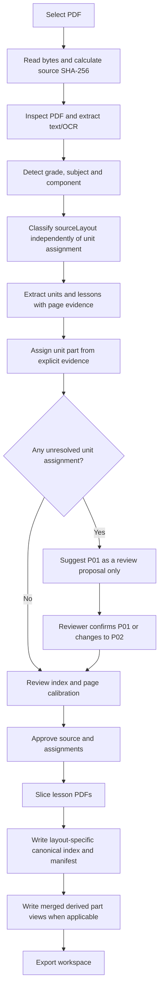

# the former indexing workflow Workspace Preparation Algorithm

## 1. Responsibility boundary

This document describes the producer contract that Edu Mini consumes. the former indexing workflow owns PDF discovery, curriculum identity, source-layout classification, unit-part assignment, index review, page calibration, lesson slicing, file paths, manifests and hashes.

Edu Mini must consume the prepared workspace. It must not duplicate the PDF classifier, infer part assignments, rebuild lesson paths when `sliceFile.workspaceUri` exists, or slice the source PDF again.

The the former indexing workflow implementation is the authority for actual behavior. Where this document describes the target layout not yet implemented, the status is explicitly marked below.

## 2. End-to-end preparation sequence



A proposal must never be silently converted into a confirmed assignment. The approval gate must reject unresolved units.

## 3. Source layout and unit assignment are separate

### 3.1 `sourceLayout`

- `SINGLE_PART_FILE`: the uploaded PDF is confirmed to contain one part only; a P01/P02 cover label by itself is not sufficient evidence.
- `MERGED_PARTS_FILE`: the uploaded PDF is one source containing both parts.
- Unknown or conflicting evidence remains under review; it must not be converted to a single-part source merely because the TOC is unclear.

### 3.2 Unit assignment

For each unit, preserve:
- confirmed `partKey` or `unknown`;
- `assignmentStatus`;
- optional `proposedPartKey`;
- `assignmentEvidence`;
- `assignmentSource`: `INDEX_EVIDENCE`, `REVIEWER`, `DEFAULT_PROPOSAL`, or `LEGACY_UNVERIFIED`.

Automatic assignment requires explicit source evidence such as a TOC section, unit title/heading evidence or a verified standalone-source part. Unit number alone is never evidence.

For an unresolved unit in a confirmed merged source, The app-owned intake workflow may propose P01 as a default review suggestion. The UI must display the proposal and require an explicit reviewer action to confirm P01 or choose P02. Until that action, keep `partKey=unknown`, `assignmentStatus=need_review`, and keep the source `sourceLayout=MERGED_PARTS_FILE`.

A manual decision must be recorded as reviewer provenance. A confirmed proposal must not be recorded as automatic evidence.

## 4. Workspace layout

### 4.1 Independent single-part PDF — target layout

For a P01 source:

```text
workspace/<gradeKey>/<subjectKey>[/<componentKey>]/
  P01/
    index.json
    book_manifest.json
    cover.png
    units/<unit-folder>/lesson_<nn>.pdf
```

For P02, use the P02 directory. No root `index.json` is written for an independent source. The part-local manifest carries that source's `sourceSha256` and canonical index path/hash.

### 4.2 One merged PDF — target layout

```text
workspace/<gradeKey>/<subjectKey>[/<componentKey>]/
  index.json
  book_manifest.json
  cover.png
  P01/
    index.json
    cover.png
    units/...
  P02/
    index.json
    cover.png
    units/...
```

The root index is the one canonical complete index. Part indexes are derived filtered views. They retain the merged source identity and must never be treated as independent books.

### 4.3 Merged source requiring assignment review

Keep `sourceLayout=MERGED_PARTS_FILE`. The unresolved intake draft remains in the review state; do not export a final workspace, root manifest, derived part indexes, or lesson slices until all required assignments are explicitly confirmed. After confirmation, export one root canonical index and its derived part views.

## 5. Canonical identity and display values

Use `gradeKey`, `subjectKey`, and optional `componentKey` as stable identity. The Arabic display names in the prepared index (`displayName`, `subjectName`, and `componentName`, when provided) are the preferred labels for UI presentation. Consumers may use a local catalog only as a fallback. Never derive a canonical key from a display name.

## 6. Lesson file references

Each sliced lesson must carry a workspace-relative `sliceFile.workspaceUri` that resolves to the exact generated PDF. This path is authoritative for consumers. Paths must be normalized and constrained to the workspace root.

Consumers should use that explicit reference directly. Reconstructing `P01/units/unit_01/lesson_01.pdf` from numbers is only a legacy fallback for old packages with no explicit path.

## 7. Manifest and hashes

The current TypeScript exporter writes `edu.book_manifest.v2` with:
- `canonicalIndexPath` and `canonicalIndexSha256` for the canonical index;
- `indexSha256` as a compatibility alias for that canonical hash;
- `partIndexes` containing each derived part path and its independent SHA-256;
- `sourceSha256`, `sourceLayout`, `sourceReviewStatus`, identity keys, cover paths and export counts.

For a standalone source, the canonical index is `P01/index.json` or `P02/index.json` and its manifest is beside it. For a merged source, the canonical index is root `index.json` and derived part views are inside P01/P02. Hashes are calculated from the exact serialized bytes written to each file.

## 8. Current implementation status (verified snapshot)

The following changes are now present in the TypeScript main path:
- shared types define `assignmentStatus`, `proposedPartKey`, `assignmentSource`, and `assignmentEvidence`;
- the extraction schema accepts assignment provenance, and the extraction prompt requires explicit evidence for `assigned`; the model must not invent a P01 proposal;
- source layout is derived from PDF discovery evidence or an explicit reviewer choice, not from filename, model output, or top-level partKey alone; a cover label P01/P02 identifies a candidate part but does not prove the PDF is standalone. Automatic SINGLE_PART_FILE classification requires explicit standalone wording; otherwise the UI requires a reviewer to select the physical layout;
- the intake UI adds a P01 proposal only for unresolved units in a source already classified as merged, displays it as unconfirmed, and records reviewer confirmation when P01/P02 is selected;
- approval and slicing reject an unresolved `sourceLayout`, a source-level `partKey` that conflicts with the layout, or any unit without `assignmentStatus=assigned`, trusted `assignmentSource`, and non-empty `assignmentEvidence`;
- the exporter writes an independent source's canonical index and manifest inside P01/P02; a merged source retains one root canonical index and may write filtered part views;
- manifest v2 records the canonical index path/hash and an independent hash for each derived part index;
- lesson records retain `sliceFile.workspaceUri`, which is the consumer-facing path.

The repository has no successful CI status attached to the latest commits in this session, and no TypeScript build or automated test suite was run here. The legacy Python paths referenced by older algorithm notes were not found in the current `main` tree; those notes are now marked historical. The TypeScript path is the current implementation under review, but full runtime compatibility remains unverified until the project's build/tests and workspace upload/download flow are executed.
## 9. Consumer requirements for Edu Mini

Edu Mini must:
1. discover root and part-local index files;
2. pair each canonical index with the manifest beside it;
3. classify a part-local standalone index separately from a merged derived view;
4. bind a merged root index exactly once and not create duplicate books from its derived indexes;
5. verify every declared hash against its own file;
6. use index-provided display labels when present, with local catalog fallback;
7. resolve lessons from `sliceFile.workspaceUri` first;
8. preserve legacy workspace import support without letting legacy fallbacks override valid explicit references.

## 10. Non-negotiable invariants

- Unclear TOC evidence never changes a merged source into a standalone source.
- P01 proposal is not confirmed assignment.
- A standalone source has a part-local canonical index.
- A merged source has one root canonical index; part indexes are derived.
- Each source PDF has its own source SHA-256.
- Each index hash belongs to the exact index file it describes.
- The application consumes the app-generated workspace; it does not reimplement its indexing logic.


## 11. App-owned book intake and indexing workflow

The indexing algorithm is a first-class capability of ai_books. Removing an external runtime dependency does not remove, simplify away, or discard the algorithmic principles described above. The app owns PDF intake, discovery, index drafting, review, approval, slicing, hashing, validation and Workspace creation.

### 11.1 Intake sequence

1. The user selects a PDF. The app stages it locally, records its original filename, SHA-256 and physical PDF page count, and inspects text/OCR availability.
2. The app discovers candidate curriculum metadata: grade, subject, book title, source layout and possible part. Discovery can use local rules/catalogues, a reusable built-in template, or an AI prompt template. These are alternative discovery methods over the same output contract, not separate index formats.
3. The discovery step inspects the table of contents and relevant page regions to propose unit titles, lesson titles, printed page ranges, candidate part assignments and evidence. It must not fabricate missing values.
4. The user sees one editable review screen containing grade key/name, subject key/name, book title, source layout, source part, selected template, offset, units, lessons, part assignments and page ranges.
5. The user may edit any proposed value, select a different reusable template, switch between built-in parsing and AI-assisted extraction, or complete the index manually.
6. The user explicitly confirms the reviewed metadata. Only a valid confirmed draft can become an approved canonical index and proceed to final PDF slicing.
7. The app writes the canonical index and matching v2 book manifest from the same approved in-memory model, calculates hashes from the exact serialized bytes, validates the result, then creates lesson slices and Workspace records.

### 11.2 Reusable index fields

The shared index-intake contract must carry grade display name and stable grade key; subject display name and stable subject key; book title and optional component key; source filename, SHA-256 and physical PDF page count; source layout and source-level part; reusable template ID and discovery method; offset and explicit printed-page / physical-PDF-page values; stable unit and lesson keys, display names, unit-to-part assignment, assignment status/source/evidence; reviewer confirmation and review provenance.

Display names never replace canonical keys. A discovered subject label must be matched to a known catalogue key or explicitly confirmed/created by the user; never derive a canonical key by slugifying an Arabic display name.

### 11.3 Printed page and PDF page mapping

Physical PDF page = printed page + offset is the sole fallback mapping when physical PDF page values are not explicitly available. If pdfPageStart / pdfPageEnd are already present, do not apply offset again. Validate the resulting physical range against the actual PDF page count. Keep printed numbering and physical PDF numbering as separate values.

### 11.4 Evidence and approval rules

- AI or local discovery creates a draft, not an approved index.
- A proposed part assignment remains NEEDS_REVIEW until the user confirms it.
- Unit number alone is not evidence for a part assignment.
- Unknown source layout blocks final approval and slicing.
- An independent source requires P01 or P02; a merged source uses BOTH at source level and confirms each unit's part independently.
- Every automatically assigned part must retain its source evidence; every manual assignment must identify the reviewer as its source.
- The UI must preserve the user's edits when changing discovery method or regenerating proposals. Regeneration must not silently overwrite confirmed fields.
- Failure to extract a TOC or OCR text must expose manual entry; it must not create fake unit/lesson names or evenly spaced page ranges and label them as discovered.

### 11.5 Templates and provider independence

Index templates are reusable application resources, not an external tool's private implementation. A template defines its extraction instructions, required fields, response schema/version and validation rules. The user can select a built-in deterministic template or an AI prompt template. Both must produce the same BookIndexIntakeDraft contract. Provider/model selection belongs to the AI execution layer and must not change the index schema or approval rules.

The reusable prompt should focus on extracting unit name, lesson name, unit-to-part relationship, printed page start/end, subject name/key, grade name/key and evidence. Offset mapping is applied by the app's deterministic page-mapping function, not delegated to the model.

### 11.6 Implementation boundary

The app-owned intake data contract and validation are the shared boundary. UI, PDF extraction, OCR, built-in parsers and AI providers are adapters that populate or edit this draft. The canonical index serializer and manifest writer consume only the approved contract. This prevents discovery-specific formats from leaking into Room, the canonical JSON index, the student package or the Android consumer.
