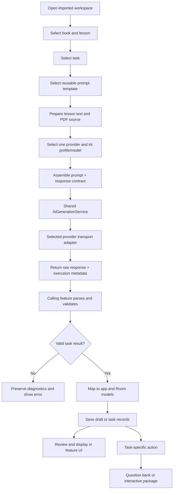

# Edu Mini Generation Studio — Functional, Template and Provider Contract

**Document status:** corrected against the current Android implementation and the accepted design decisions  
**Scope:** Generation Studio, reusable prompt templates, source PDF attachment, database-derived response contracts, shared AI execution, provider isolation, exact model selection/retry policy, draft persistence and future work.

This document distinguishes three states throughout:

- **Implemented:** verified in the current source tree.
- **Required design:** an accepted architectural rule that must govern future changes.
- **Not implemented / limitation:** a capability that must not be presented as complete.

Primary implementation references:

- `app/src/main/java/com/example/ui/screens/StudioScreen.kt`
- `app/src/main/java/com/example/ui/MainViewModel.kt`
- `app/src/main/java/com/example/data/repository/EduMiniRepository.kt`
- `app/src/main/java/com/example/data/ai/AiGenerationService.kt`
- `app/src/main/java/com/example/data/ai/ProviderRoutingPolicy.kt`
- `app/src/main/java/com/example/data/ai/GeminiModelRouter.kt`
- `app/src/main/java/com/example/data/ai/BookIndexPromptRegistry.kt`
- `app/src/main/java/com/example/data/ai/TemplateResponseAdapter.kt`
- `app/src/main/java/com/example/data/ai/TemplateOutputValidator.kt`
- `app/src/main/java/com/example/data/security/ProviderStorage.kt`
- `app/src/main/java/com/example/data/local/EduMiniDatabase.kt`
- `app/src/main/java/com/example/model/Models.kt`

---

## 1. Product responsibility and boundaries

Generation Studio is the lesson-aware authoring workspace. It receives an already identified lesson from the imported workspace and generates editable educational content against that lesson's source material.

The lesson-generation feature owns task orchestration. The reusable AI execution service owns provider transport only.

The calling feature (through its ViewModel/repository or a focused use case—not inside a Compose screen) selects the lesson/task, prepares source attachments and context, resolves the database-derived response contract, assembles the prompt, selects provider/profile/model, calls the shared service, parses and validates the returned data, maps it to application/database models, decides persistence/review actions, and presents feature state.

AiGenerationService must not know about LessonRef, task-specific business rules, question parsing, index semantics, learner analytics, recommendations, Room entities or Compose screens. It accepts a fully prepared request, executes it through the selected provider API, and returns raw provider response with execution metadata.

The Studio is **not** responsible for re-indexing the source book, changing the workspace's canonical index, or creating a permanent lesson JSON snapshot.

### Source-of-truth boundaries

- Workspace `index.json` and `book_manifest.json` remain authoritative for book, unit, lesson, part and page identity.
- The selected lesson PDF remains the primary document source for generation when attached.
- Prompt templates define reusable task instructions and prompt metadata; they do not override the authoritative database response contract.
- Room/database schema is the source of truth for persisted data. A task-specific AI-writable projection is derived from it; application-owned IDs, relationships and audit fields are added locally.
- The provider response is untrusted until the calling feature parses and validates it.
- A generated draft is application-owned content; it does not overwrite the imported workspace.
- A future persistent lesson text/JSON snapshot is a separate, deferred feature. It must not be silently introduced as a side effect of generation.

## 2. End-to-end Studio workflow



A request must have a selected lesson and at least one usable source: non-empty source text or an enabled, readable lesson PDF attachment. The UI must not submit an empty-source request.

The selected provider is captured for the request. Changing the default provider affects subsequent requests, not a request already in progress.

## 3. Lesson context, post-segmentation extraction and source selection

### 3.1 Pipeline boundary: extraction happens after lesson segmentation

The source-processing lifecycle has distinct stages:

1. **Book segmentation:** identify unit/lesson boundaries and create a separate PDF file for each lesson.
2. **Lesson source preparation:** process each lesson-level PDF to produce an optional text sidecar.
3. **Generation Studio:** select the lesson and choose which available representation to send with the generation prompt.
4. **Provider transport:** encode the selected representation in the format supported by the chosen provider.

Text extraction is therefore a **post-segmentation preparation stage**, not part of book segmentation and not an implicit side effect of every Generation Studio request.

The intended workspace relationship is:

- `lesson_XX.pdf`: the segmented source PDF for one lesson;
- `lesson_XX.txt`: optional extracted text for that same lesson;
- `lesson_XX.extraction.json`: optional extraction metadata/provenance;
- `index.json`: canonical lesson identity and references such as `pdfPath` and `sourceTextPath`.

The PDF is the primary source artifact. The TXT file is a derived, optional representation. It must never replace the PDF or become the authority for lesson identity/page boundaries.

### 3.2 Lesson extraction methods

The extraction process operates on the already segmented lesson PDF, not the original whole-book PDF.

The supported design should allow these methods:

1. **Embedded PDF text extraction:** use the PDF's existing text layer when it is present and sufficiently complete. This is preferable to OCR for born-digital PDFs because it avoids recognition errors.
2. **OCR extraction:** for scanned/image-only pages or pages whose embedded text is missing/unusable, run OCR with both Arabic and English language support. Preserve reading order, page boundaries, Arabic shaping/direction, and mixed Arabic/English passages. Record OCR engine/language configuration and confidence or quality indicators.
3. **AI-assisted transcription:** optionally send the lesson-level PDF to a vision-capable AI model with a dedicated *verbatim transcription* prompt and request the lesson text, preserving headings, paragraphs, lists, tables and page markers. This is an extraction operation, not the later educational generation task (summary, explanation, questions, etc.).

**Recommended extraction policy:** inspect the embedded text layer first; use OCR for scanned or poor-text pages; offer AI-assisted transcription as an explicit alternative or recovery path when OCR quality is inadequate or page layout is complex. Do not silently replace low-confidence OCR with AI output. AI transcription can omit, normalize or hallucinate text, so it must be checked against the PDF and marked as AI-derived.

Do not combine OCR and AI outputs by blindly concatenating them. If both are run for quality comparison, retain separate candidates and require a deterministic selection/review step to avoid duplicated or conflicting paragraphs.

The extraction stage should produce one chosen text artifact per lesson, with a clear method and provenance. It should not summarize, simplify, generate questions, or rewrite the educational content. Those are separate Generation Studio tasks.

### 3.3 Verified current implementation and integration gaps

The inspected code confirms some foundations, but not the complete extraction workflow:

**Workspace segmentation**
- `PdfBookSplitter` creates separate lesson-level PDF files from page ranges.
- It writes a `sourceTextPath` reference such as `lesson_XX.txt` into the workspace index.
- It also accounts for a possible `.extraction.json` sidecar when reporting existing split files.
- Writing the expected `sourceTextPath` into the index does not itself create the extracted TXT file. A missing sidecar must remain an absent optional artifact, not be treated as an extraction success.

**Current text extraction in Indexer2**
- `server/index.ts` contains `extractPdfText()`, which reads the embedded PDF text layer page by page using PDF.js.
- It adds physical PDF page markers and stops at a default maximum of 80,000 characters.
- `readLessonSources()` calls it for a resolved lesson PDF and also reads/Base64-encodes that PDF for Indexer2's own server-side AI workflow.
- This function does not perform OCR for image-only pages, does not itself create a durable `.txt` sidecar, and does not expose a complete per-page extraction-quality/truncation contract.
- It does not apply the lesson's `pdfPageStart`/`pdfPageEnd` values itself. In the intended post-segmentation workflow, it should receive the already sliced lesson PDF; it must not silently be given a whole-book PDF and assumed to know lesson boundaries.

**Current Android workspace reading**
- `LessonRef` has an optional `sourceTextPath`.
- `StudentStudyDialog` reads the referenced text file when it exists and can fall back to sibling `.txt`/`.md` files for displaying lesson content.
- This proves that the workspace can carry and display an extracted text sidecar. It does not prove that Generation Studio consumes that file.

**Current Generation Studio behavior**
- The Studio currently exposes an editable `sourceText` field and a PDF-attachment checkbox.
- The PDF checkbox defaults to enabled.
- The generation path uses the text entered/provided in `sourceText`; it does not currently load `lesson.sourceTextPath` as the default generation text source.
- If source text is present while PDF attachment remains enabled, the current request can send both the text and the PDF/page images.
- If source text is empty but PDF attachment is enabled, the request can still proceed using the PDF.
- Therefore the current UI is not yet the required mutually exclusive `PDF` / `EXTRACTED_TEXT` source selector, and it does not automatically fall back from a missing TXT sidecar to a selected PDF mode. This is a concrete implementation gap, not merely a documentation issue.

### 3.4 User-facing source selection and default behavior

The user-facing source choice must be independent of provider transport and prompt-template response schemas.

Use exactly these conceptual choices:

| Choice | Definition | Availability |
|---|---|---|
| `PDF` | Send the segmented lesson PDF as the source input alongside the prompt. | Always the default when a valid lesson PDF exists. |
| `EXTRACTED_TEXT` | Send the extracted lesson text file (`sourceTextPath`) as text alongside the prompt. | Offer only when the referenced text file exists, is readable and passes basic completeness checks. |

Required behavior:

- **PDF is the default source mode**, including when a TXT sidecar exists, unless the user explicitly selects `EXTRACTED_TEXT`.
- If the TXT file is absent, empty, unreadable or invalid, disable `EXTRACTED_TEXT` and use PDF. Do not show an empty text option or submit a blank source.
- If the TXT file exists, show the user that it is the extracted lesson text and allow the user to choose it.
- Choosing `EXTRACTED_TEXT` sends the text file content and does not attach PDF/image pages in the same request.
- Choosing `PDF` sends the lesson PDF and does not also send the TXT content by default.
- Keep manually entered supplementary instructions separate from the source artifact. If manual source editing is retained, label it as an explicit override/edited source, not as if it were the canonical extracted TXT file.
- If neither a valid PDF nor a valid extracted text file exists, block generation and explain what is missing.
- Record the selected mode and the actual source artifact/hash in the draft provenance and request fingerprint.

The current Room field `source_attachment_mode` is stored on the template, but the user's source choice is request-specific. Do not let a prompt template silently force PDF versus text. Treat the existing field as a legacy provider-attachment setting during migration; introduce a request-level source mode and deprecate the template-level source choice deliberately rather than overloading one field with two meanings.

### 3.5 Provider transport for the selected source

Provider differences are transport details, not differences in the meaning of the user's choice.

| User-selected source | Gemini transport | OpenAI-compatible transport |
|---|---|---|
| `PDF` | Prefer the original segmented lesson PDF as an `application/pdf` input part when supported by the selected model/profile. | Render pages from the segmented lesson PDF as image input parts for vision-capable endpoints. Do not assume universal native-PDF support across compatible endpoints. |
| `EXTRACTED_TEXT` | Send the TXT content as text with the prompt. | Send the TXT content as text with the prompt. |

Current Android provider transport:
- Gemini supports the original PDF as `application/pdf` inline data in `pdf_native` mode, and rendered JPEG page images in `rendered_pages` mode.
- OpenAI-compatible requests currently use rendered JPEG page images when PDF attachment is enabled.
- The OpenAI-compatible renderer currently samples up to four pages distributed across the referenced PDF. This is not equivalent to sending every page and must not be described as full-document delivery.
- The current PDF attachment limit for the native Gemini path is 18 MiB.
- When the lesson reference points to a correctly segmented lesson PDF, the entire lesson PDF is the intended input. If it points to a whole-book PDF, the current native Gemini path can attach the whole book; this must be prevented by workspace validation or corrected before dispatch.

**Terminology:** rendered JPEG pages are images sent *to the model as source input*. They are not images returned by the model. Generated image output is a separate response modality and task contract.

Printed page numbers and physical PDF page numbers are different coordinate systems. Since this stage runs after segmentation, the lesson PDF itself should be the bounded source. Retain the original book page range only as metadata; do not re-slice the lesson PDF using printed page numbers.

### 3.6 Extraction artifact contract

Indexer2 should own the canonical extraction implementation and expose its result to the workspace/Android importer through a stable, versioned artifact contract. Do not implement a second competing PDF-to-text algorithm inside Generation Studio.

The extraction metadata should include at least:

- workspace/book/unit/lesson identity;
- lesson PDF relative path and SHA-256;
- extraction artifact path and text SHA-256;
- extraction method (`embedded_text`, `ocr`, or `ai_transcription`), including per-page method if mixed;
- language configuration (Arabic, English, or both);
- page count and page markers;
- OCR confidence/quality indicators where available;
- completeness/coverage and whether any content was truncated;
- extraction tool/model and version;
- extraction prompt version/hash for AI transcription, without storing provider secrets;
- extraction timestamp and artifact schema version;
- review status when quality is below the configured threshold or AI transcription was used.

The processing order should be:

1. Confirm segmentation is complete and reviewed; identify the separate lesson PDF.
2. Validate the lesson PDF and compute its SHA-256.
3. Inspect the embedded text layer and measure whether it is usable.
4. Extract embedded text where adequate; run Arabic+English OCR on pages needing recognition.
5. If the user/operator selects AI-assisted transcription or OCR quality is inadequate, send only that lesson PDF with the dedicated transcription prompt. Validate that the returned text covers the expected pages and preserves page markers.
6. Compare quality/completeness signals; retain the selected candidate and mark review needs. Never label a truncated/low-confidence result as complete.
7. Save the chosen lesson text as the optional `.txt` sidecar and extraction metadata as `.extraction.json`, then update/verify the workspace reference.
8. Generation Studio reads the TXT sidecar only when the user selects `EXTRACTED_TEXT`; otherwise PDF remains the default source.

The TXT sidecar is a derived, regenerable artifact. It does not become a permanent canonical lesson JSON snapshot, does not replace the PDF, and does not rewrite the canonical lesson identity in `index.json`.

### 3.7 Privacy and quality boundaries

- Text sent to a provider must pass the text privacy policy. This does not redact personal information embedded in PDF pages or images.
- The UI must disclose which representation will be sent to the selected external provider.
- AI-assisted transcription is itself an external AI request and may incur provider cost. It must be a separately identifiable operation from lesson explanation/question generation.
- Preserve page references so a teacher can compare extracted passages with the original PDF.
- Do not claim OCR or AI transcription is perfectly accurate. For Arabic/English mixed content, verify reading order, punctuation, diacritics where relevant, tables, equations and right-to-left layout.
- Do not silently send both PDF and TXT. A future comparison/debug mode may send both only when explicitly selected and clearly disclosed.


## 4. Prompt templates are the generation contract

### 4.1 Template contents

A reusable prompt template is more than a prompt string. The Room `prompt_templates` record stores:

| Field | Meaning |
|---|---|
| `id` | Stable template identity |
| `title` | User-facing template name |
| `task` | Generation task to which the template applies |
| `instructions` | Reusable task instructions |
| `response_schema_json` | Legacy provider-facing schema field retained for compatibility and permitted non-persistent outputs; not authoritative for database-backed tasks |
| `response_mapping_json` | Legacy field mapping retained for compatibility; database-backed tasks use the mapping generated with the database-derived response projection |
| `response_format` | `text` or `json` |
| `source_attachment_mode` | Source attachment policy, currently defaulting to `pdf_native` |
| `version` | Template version, incremented when an existing template is edited |

The prompt instructions and template version belong to the template. The authoritative response contract for persisted records is derived from the current Room/database schema through section 16. A user-editable template must not redefine database columns, required fields, enum values, relationships or persistence metadata.

Legacy response_schema_json and response_mapping_json fields remain for compatibility and explicitly permitted non-persistent outputs. They are not authoritative for database-backed tasks such as question insertion, index intake or learner-assessment records.

The selected template is resolved by its explicit ID first, with a task-compatible template as fallback. The request uses the selected template's instructions and version; the feature independently resolves the matching database-derived response contract.

### 4.2 Built-in and custom templates

- Built-in templates are inserted idempotently into Room from the repository's default template definitions.
- Custom templates are stored in Room and can be edited or deleted.
- Editing an existing template increments its version.
- The prompt blueprint registry provides task-level prompt metadata and asset paths.
- The prompt asset and the persisted template are complementary: the asset provides the base task blueprint; the Room template supplies the reusable selected instructions and response contract.

Current task identifiers:

| Task ID | Purpose |
|---|---|
| `explanation` | Lesson explanation |
| `summary` | Lesson summary |
| `objectives` | Learning objectives |
| `vocabulary` | Vocabulary/glossary |
| `worked_examples` | Worked examples |
| `lesson_review` | Lesson review |
| `difficulty_adapter` | Difficulty adaptation |
| `interactive` | Interactive lesson/activity |
| `questions` | Question bank |

The registry contains task blueprints for these task types. The repository currently seeds a smaller set of built-in prompt-template records; do not assume that every task already has a separate built-in Room template.

### 4.3 Required template behavior

A template carries reusable task instructions, task identity and version. For structured output, the calling feature resolves the response format, JSON Schema generated from the current database schema's AI-writable projection, deterministic mapping into the canonical application/Room model, and prompt/template/source provenance.

The AI response is generated dynamically according to the resolved task contract. Do not hardcode a fixed response paragraph or duplicate a database schema in the provider service. The service receives the already resolved schema as request data and does not interpret it.

Changing the lesson, task, prompt instructions, database-derived schema version/hash, attachment mode, provider or model must be reflected in request provenance.

### 4.4 Template validation

**Implemented:**

- The save path checks that schema and mapping inputs parse as JSON objects.
- Before a JSON generation request, `TemplateOutputValidator` checks the schema structure.
- For legacy non-persistent template outputs, the response may be validated against the template schema. For database-backed tasks, validation must use the schema generated from the current Room/database AI-writable projection; a template-stored schema must not override it.
- An invalid provider output is recorded as a validation failure and is not saved as a normal draft.
- The supported validator subset includes object, array, string, number, integer, boolean and null types, object properties/required fields, array items, enum and boolean `additionalProperties`.

**Limitations and required hardening:**

- The validator is a deliberately limited JSON Schema subset, not a complete JSON Schema implementation.
- The current template save path checks JSON-object syntax but does not run the full schema validator before persisting the template.
- The mapping is checked as a JSON object, but its semantic references are not comprehensively validated at template-save time.
- The Settings editor does not currently expose every stored contract field, including a complete response-format and attachment-mode editor.

Before expanding template editing, validate the complete schema and mapping contract before saving. Display field-specific errors and preserve the previous valid template when validation fails. Do not silently downgrade an invalid JSON template to text output.

## 5. Response mapping and canonical application payload

The provider-facing schema is a generated view of the canonical database contract, not a separately maintained source of truth. It contains only fields that the model is allowed to author. Application-managed persistence fields are added by the calling feature after validation.

Example mapping:

```json
{
  "rootArray": "items",
  "targetArray": "questions",
  "fields": {
    "prompt": "stem",
    "options": "choices",
    "correctAnswer": "answer",
    "rationale": "explanation"
  }
}
```

Meaning:

- `rootArray`: provider's source array name;
- `targetArray`: canonical root array name; defaults to `questions` when omitted;
- `fields`: canonical field name mapped to the provider's field name.

The adapter:

- parses the response when possible;
- adds the canonical root array when a source root array is mapped;
- recursively adds canonical field aliases when the provider's field exists;
- preserves original provider fields;
- does not delete source fields or mutate the stored template.

For an interactive contract, `targetArray` may be `steps`. This adapter is a compatibility layer, not an arbitrary Room schema migration engine. Changes to Room entities or application data semantics still require explicit application code and database migrations.

## 6. Provider isolation

### 6.1 Supported provider types

The current provider enum contains:

- `GEMINI`
- `OPENAI_COMPATIBLE` (user-facing label: OpenAI)

An OpenAI-compatible profile contains its own base URL, API key, model, enabled state, priority and fallback-model list. It must not inherit Gemini model names, keys, cooldown state or provider-specific response assumptions.

### 6.2 Required isolation rule

**A provider failure must never silently switch the request to a different provider.**

If Gemini is selected:

- only enabled Gemini profiles are eligible;
- Gemini model candidates come only from that Gemini profile's primary/fallback model list;
- Gemini-specific request format, PDF handling, error classification and cooldown logic apply;
- OpenAI is not a fallback destination.

If OpenAI-compatible is selected:

- only enabled OpenAI-compatible profiles are eligible;
- only that profile's OpenAI-compatible model list and base URL apply;
- OpenAI-compatible request construction and error handling apply;
- Gemini keys, model candidates and cooldowns are not consulted.

A user who wants to try the other provider must explicitly change the selected provider and start a new request. Provider switching is not an automatic retry policy.

### 6.3 One shared execution service with private provider adapters

The application exposes one task-neutral request entry point through AiGenerationService. The service contains private provider-specific transport adapters such as callGemini and callOpenAiCompatible, but callers do not invoke separate public generation engines.

The shared service owns dispatch to the explicitly selected provider/profile/model, provider-specific HTTP payload construction and attachment encoding, cancellation, bounded transport retries, provider error classification, rate-limit/cooldown handling, usage metadata, raw response extraction and a common result envelope.

The calling feature owns prompt construction, task/schema selection, JSON parsing, schema/domain validation, response interpretation, field mapping, database writes, review state and UI presentation. The service must not run QuestionBankEngine, map index JSON into intake drafts, calculate learner scores or interpret student mistakes. Provider-specific methods remain private transport adapters under the same service; do not create separate public AI services.

## 7. Model fallback and overload handling

### 7.1 Configured candidate order

A provider profile stores:

- primary model;
- ordered fallback model IDs;
- `strictModel`.

Provider profiles retain an ordered primary model and fallbackModels list. The active execution path now uses the UI-selected model first, followed by configured same-provider Gemini fallbacks. The selected API profile is attempted first, then other enabled profiles belonging to the same provider are eligible according to the provider-specific failover rules. OpenAI-compatible model selection remains fixed; its fallback path rotates API profiles/keys, not providers.

Current policy: keep provider selection explicit and isolated, but permit configured same-provider fallback. For Gemini, make up to three actual dispatch attempts per model on transient overload/rate-limit/network/server failures, then move to the next configured Gemini model. A confirmed daily/project quota exhaustion or invalid key skips the current API profile immediately and tries another enabled Gemini profile. OpenAI-compatible requests keep the selected model, retry transient failures up to three dispatches, then move to another enabled OpenAI-compatible profile/key; invalid key and confirmed quota exhaustion move to the next key immediately.

### 7.2 Current Gemini behavior

The current generation path filters profiles by the selected provider and orders the selected profile first. Gemini retries a saturated model up to three times, marks only that profile/model pair cooling down, and then tries the next configured model. It moves to another Gemini API profile only when the current profile is quota-exhausted, invalid, or otherwise unavailable. OpenAI-compatible requests retain the chosen model and can move to another same-provider API key after three transient failures, or immediately for confirmed quota exhaustion/invalid credentials. No cross-provider fallback occurs.

The active task-neutral AiGenerationService.execute(AiExecutionRequest) dispatch path uses ProviderRoutingPolicy.orderedProfiles() and modelCandidates(profile, requestedModelId). The older generate(lesson, task, ...) method is now a compatibility adapter that prepares the lesson prompt and delegates to execute().

### 7.3 Current OpenAI-compatible behavior

OpenAI-compatible profiles use their own configured candidate model list and their own request function. They do not use Gemini cooldown state or Gemini model identifiers.

A provider switch is explicit. A failed OpenAI request must not dispatch Gemini automatically, and a failed Gemini request must not dispatch OpenAI automatically.

### 7.4 Retry policy requirements

For future hardening, keep the failure categories distinct:

| Failure | Required handling |
|---|---|
| Authentication/permission (401/403) | Mark the affected profile invalid/permission-failed; do not retry the same credentials repeatedly |
| Confirmed quota exhaustion | Stop requests that would bypass the provider's quota; show a clear quota message and retry guidance |
| Temporary rate limit / overload (429) | Respect `Retry-After`; apply cooldown to the affected model/profile according to provider semantics; try only configured models within the selected provider |
| Transient server failure (5xx) | Bounded retry with exponential backoff and jitter, then continue only within the selected provider's configured candidates |
| Network/timeout | Bounded retry; preserve the user's prompt and source selection |
| Invalid request/schema/model | Do not repeat an unchanged invalid request; report the precise cause |
| User cancellation | Cancel the active HTTP call and do not continue fallback attempts |

The current code already separates several of these cases, but its retry/backoff policy and Gemini cooldown persistence remain narrower than this target contract. Do not describe the target policy as fully implemented until tests prove each branch.

## 8. Provider profiles, secrets and request telemetry

Provider profiles are encrypted at rest using an Android Keystore-backed key and authenticated encryption. The profile contains the provider type, label, model, endpoint, API key, enabled state, priority, fallback model list, strict-model setting and runtime status.

Rules:

- Never include API keys in prompts, logs, draft provenance, backups or Firestore.
- Mask secrets in the UI.
- Test-connection must test only the selected provider profile and its configured model.
- Runtime status and last-used information may be stored locally.
- The application must not claim that encryption at rest makes an API key impossible to extract from a distributed APK. A public release should use a controlled backend for provider credentials and request dispatch.

### 8.1 Daily request counters

The current `dailyRequestLimit` and `dailyRequestsUsed` fields are not an authoritative local quota gate. `ProviderStorage` explicitly treats the counter as diagnostic telemetry and relies on the provider response for actual quota status. Do not promise that the app enforces a daily request cap until that behavior is deliberately implemented and tested.

Quota date normalization uses each profile's configured timezone. Provider runtime status and `Retry-After` timestamps are retained separately from the prompt-template data.
### 8.2 Central system-admin model catalogue

Model metadata and model identifiers are defined by
`app/src/main/java/com/example/data/ai/AiModelCatalog.kt`. Runtime request
methods must not embed model IDs or maintain independent model preset lists.

The authoritative catalogue is the global Firestore collection
`ai_model_catalog/{modelId}`. Every authenticated app user may read the
catalogue. Only a user with both the pre-provisioned `users/{uid}.role = admin` role and
an explicit `system_admins/{uid}` grant containing `enabled: true` and
`permissions: ["manage_ai_models"]` may create, edit, rename, enable/disable,
set defaults, or delete entries. Provision this grant through Firebase Console
or a trusted Admin SDK process; client rules deny all writes to `system_admins`.
The Firestore rules are the security boundary; hiding controls in Compose or
checking the local UI role is not sufficient authorization.

The local SharedPreferences key `edu_mini_ai_model_catalog_v1` is retained
only as a legacy/offline seed/cache. It is not authoritative for authenticated
users and does not grant model-management rights. API credentials remain
separately encrypted in `edu_mini_ai_profiles_v1`.

The generation dialog presents two independent selections:
- a model that is enabled and supports generation in the central catalogue;
- an enabled API profile for the selected provider.

The selected model ID and profile ID are required parameters throughout
`EduMiniRepository.generateContent` and `AiGenerationService.generate`.
The request uses the exact selected model ID and exact selected profile; it
does not silently substitute a profile fallback model or another API profile.
The default model is only the initial selection in the dialog. Concept
remediation uses the system default model and an available profile.

Model IDs are the provider-facing version identifiers. Renaming an ID creates
the new catalogue document and retires the old document; a default entry is
transferred before the old document is deleted. A disabled or deprecated
model cannot be selected for generation or made the default.

## 9. Output persistence, editing and task-specific actions

### 9.1 Draft persistence

A successful generation is saved as an application draft in the local Room database. Drafts are versioned per workspace/book/unit/lesson/task context and retain:

- provider label and actual model ID;
- template ID and template version;
- response schema hash;
- request fingerprint;
- generated content hash;
- source PDF hash;
- source page range and source text hash where available.

The generated text remains editable. Saving an edited version creates another draft version; it must not silently overwrite the previous draft. Draft approval is a separate user action.

Full local backup includes the template contract and draft provenance fields. Cloud draft synchronization may carry draft provenance, but provider secrets must never be synchronized.

### 9.2 Task-specific post-processing

- **Questions:** the generated output is saved as a draft and parsed into the question bank when the question task succeeds. Concept tags are retained or inferred by the existing question parsing path where applicable.
- **Interactive lesson:** the output is parsed into the interactive activity model. A valid activity can be built into a student-facing HTML/JS/JSON package. Checkpoint answers should be routed through the interactive question-attempt callback so learning analytics can record them.
- **Other tasks:** the generated result remains an editable lesson draft until the owning feature applies its task-specific parser and follow-up policy.

These parsers and post-processors belong to the calling feature/use case (question bank, interactive lesson, book-index intake or learner assessment), not to AiGenerationService. The Compose screen displays feature state; it does not implement parsing or persistence logic.

An interactive package is a task-specific deliverable. It is not the deferred persistent lesson JSON snapshot and must not be conflated with one.

### 9.3 Deferred persistent lesson snapshot

A permanent lesson JSON/text snapshot remains deferred. When implemented later, it should be a separate versioned artifact containing at least:

- workspace/book/unit/lesson identity from the canonical workspace;
- source PDF SHA-256;
- page range;
- extraction method (PDF text layer/OCR/manual);
- extraction timestamp;
- snapshot schema version;
- extracted content hash.

It must be regenerable and auditable, must not rewrite `index.json` or `book_manifest.json`, and must not become an implicit side effect of a normal Studio generation request.

## 10. Provenance and reproducibility

The current request seed includes template ID/version, attachment mode, task, lesson identity, page range, response schema hash, mapping hash, response format, PDF hash, source text and effective instructions. The final request fingerprint additionally includes provider, actual model and assembled prompt.

The generated result and draft retain the relevant hashes and model/template identifiers. API keys are excluded.

**Known limitation:** the current template row is updated in place when edited; the version number increments, but immutable historical copies of every prior template body/schema/mapping are not maintained as separate template revisions. A draft's version and hashes help identify its generation contract, but they do not by themselves reconstruct the exact prior template contents. If exact replay/audit is required, add immutable template revision snapshots or store a complete request-contract snapshot with the draft.

## 11. Error handling and user experience

On failure:

- preserve the selected lesson, source text, prompt instructions, selected template and provider;
- preserve existing drafts;
- show a classified, actionable error instead of a generic "generation failed";
- show which provider and model failed, without exposing secrets;
- distinguish overload/rate limit from quota exhaustion, invalid credentials, invalid model, invalid request, malformed JSON and schema mismatch;
- allow the user to retry after correcting the cause or explicitly selecting another provider;
- never report success before validation and draft persistence complete.

Progress indicators represent real pipeline stages (feature preparation, attachment preparation, provider dispatch, raw-response receipt, feature-side parsing/validation and persistence). They must not imply that response interpretation is performed by the transport service or token-by-token progress when the HTTP provider does not expose it.

A failure must identify its stage: request preparation, local attachment read/render, HTTP/network, provider rejection, provider returned no usable text, JSON parse, schema validation, task/domain validation, database mapping/insertion or UI-state delivery. Provider success followed by feature-parser failure is not an API transport failure.

## 12. Database and migration contract

The current Room schema stores the prompt-template response contract and generation provenance in addition to the original draft fields.

Migration `15 → 16` adds to `prompt_templates`:

- `response_schema_json`;
- `response_mapping_json`;
- `response_format`;
- `source_attachment_mode`;
- `version`.

It adds to `generation_drafts`:

- `template_id`;
- `template_version`;
- `response_schema_hash`;
- `request_fingerprint`;
- `content_hash`;
- `source_pdf_hash`.

The migration is additive and supplies defaults for existing rows. Release validation must test migration from every supported historical database version to the current version, not merely instantiate a fresh database. The current source includes a 15→16 migration; do not claim a tested 13→16 path unless the migration chain and tests prove it.

Template changes must not erase existing drafts or source workspace records.

## 13. Required tests and acceptance criteria

### Template and response contract
- Add/edit/delete custom templates and preserve their IDs.
- Editing increments the template version.
- Built-in templates are inserted idempotently.
- Invalid schema is rejected before the template is saved.
- Invalid mapping structure or unsupported field references produce actionable validation errors.
- JSON response is validated before adaptation and draft persistence.
- Invalid AI output is recorded as validation failure and is not persisted as a normal draft.
- Field mapping preserves original provider fields while adding canonical aliases.
- Legacy non-persistent tasks can use explicitly permitted template schemas/mappings without hardcoded response bodies.
- Database-backed tasks derive their response schema/decoder/mapping from the current Room schema and fail tests if that contract drifts.

### PDF and source
- Gemini receives the original PDF bytes as `application/pdf` with the prompt.
- OpenAI-compatible receives rendered JPEG page parts with the prompt.
- Attachment disabled means no PDF/image data is sent.
- Invalid, missing, oversized or unreadable PDFs fail before provider dispatch.
- PDF attachment privacy notice is visible and accurate.
- Source PDF hash is stable across repeated reads of the same bytes.

### Provider isolation and fallback
- Gemini failure never dispatches OpenAI-compatible.
- OpenAI-compatible failure never dispatches Gemini.
- Candidate model order follows the selected profile configuration.
- Strict model mode attempts only the primary model.
- Gemini 429 cooldown is model-scoped. After three attempts, the next configured Gemini model is tried; another API profile is selected for quota exhaustion or invalid/unavailable credentials, not as a way to bypass a model's ordinary rate limit.
- Confirmed quota exhaustion stops prohibited retries.
- OpenAI-compatible model candidates are independent of Gemini models and cooldown state.
- Provider switching affects new requests only.
- Cancellation stops the active HTTP request.

### Persistence and learning integration
- Draft provenance is saved and included in full local backup/restore.
- Editing creates a new draft version.
- Question parsing retains or infers concept tags without overwriting explicit valid tags.
- Interactive checkpoints invoke the answer callback and record attempts against the correct lesson/concept.
- Room migration tests cover every supported historical version through the current version.

---

## 14. Explicit non-goals

The following must not be silently folded into the current Generation Studio contract:

- automatic cross-provider fallback;
- automatic permanent lesson JSON snapshot creation;
- rewriting canonical workspace indexes or lesson PDFs;
- treating a prompt example as a validated JSON Schema;
- assuming all OpenAI-compatible endpoints support identical PDF or strict JSON Schema features;
- claiming local daily quota enforcement when the provider is authoritative;
- claiming that a configured model preset is available for every API key/project;
- treating an interactive student package as the canonical lesson source.


## Canonical question response contract (2026-11-27)

Question generation is intentionally different from general prompt templates:

- `QuestionContentPayload` is the canonical serializable question-content model. `QuestionResponseContract` generates the provider JSON Schema from its Kotlin serialization descriptor, while allowed type/difficulty enums are derived from `QuestionType` and `QuestionDifficulty`.
- The contract contains only model-authored question content: `type`, `conceptTag`, `prompt`, `options`, `correctAnswer`, `rationale`, `difficulty`, and optional `sourcePages`. The provider schema narrows `type` to the selected types and `difficulty` to the selected level for each request.
- Application-owned persistence metadata (workspace/grade/book/unit/lesson IDs, generated question ID, fingerprint, timestamps, review state, draft/template provenance and index hash) is never requested from the model.
- The strict parser decodes JSON into `QuestionContentPayload`, maps it to the app-owned `QuestionItem`, and `QuestionBankService` maps that model into `QuestionEntity`; `options` is encoded into the Room `options_json` column. The database remains the persistence authority.
- For `TaskType.QUESTIONS`, the runtime ignores template-level `responseSchemaJson` and `responseMappingJson`. Template instructions remain editable, but the schema and field mapping are application-owned and cannot drift independently.
- The prompt preview, Indexer2 question schema reference, built-in question template, provider request and strict parser all use QuestionResponseContract.schemaJson.
- Current limitation: QuestionResponseContract generates the schema from QuestionContentPayload.serializer().descriptor. The payload mirrors model-authored fields persisted by QuestionEntity, but it is not directly derived from Room's exported database schema. This is an interim single-contract implementation, not completion of the database-first requirement.
- Required target: derive the AI-writable question projection, JSON Schema and decoder/mapping from the current Room schema/model metadata through section 16. Exclude IDs, workspace/lesson foreign keys, fingerprints, timestamps, review flags and provenance.
- Before insertion, the feature validates JSON shape, supported enums, non-empty prompt/answer, option/answer consistency, exact requested count, exact per-type distribution, selected difficulty and within-batch duplicates. Invalid batches are rejected; invalid rows are not silently dropped.
- The original count, type distribution and difficulty are recovered from the saved generation prompt when a teacher later approves a question draft, so approval does not rely on the current Studio controls.
- Before insertion, the service also rejects a batch containing questions already stored for the same lesson. This avoids partial writes and misleading "requested count vs saved count" results.

No Room entity, column, database version, or migration was changed by this contract consolidation. This confirms that the current schema is generated from the serializable payload descriptor, not directly from Room's exported schema. Until the database-derived projection generator is implemented, changes to persisted question fields must be reconciled with QuestionContentPayload, QuestionResponseContract, the parser and QuestionEntity; tests must detect drift. Storage-only metadata remains application-managed and does not enter the model response.


## 15. One reusable AI request pipeline for content generation and book-index discovery

Book-index discovery is a different task, not a different AI integration. It must use the same request execution and provider transport already used by lesson-question generation.

### 15.1 Proven request sequence to reuse

The existing PDF lesson-question flow establishes the provider request sequence. The feature resolves the lesson PDF, prepares prompt and database-derived response contract, and calls the shared service. The service dispatches the request and returns raw response text with provider/usage metadata. The question-bank feature then parses and validates the response, maps it to application models, retains provenance and persists a reviewable draft or question batch. Semantic validation and persistence are not responsibilities of the provider transport service.

The earlier reference workflow uses the same pattern for index discovery: it supplies a sampled original-book PDF rather than a lesson PDF, and changes only the prompt, schema and task context. The important reusable behavior is the request/response contract—not the older service's key/model fallback policy.

### 15.2 Current shared Android transport

`AiGenerationService.kt` already owns:
- Gemini PDF-native attachment and Gemini structured JSON response configuration;
- OpenAI-compatible rendered-page image transport and JSON-object response mode;
- provider-specific request construction and response extraction;
- selected provider/profile/model enforcement;
- cancellation, bounded transient retries, quota reservation and rate-limit cooldown;
- provider/model and request provenance returned with `GeneratedResult`.

`EduMiniRepository.generateContent()` prepares the question task's prompt/schema/source, calls `AiGenerationService.generate()`, validates the output and invokes the question parser. It invokes `QuestionBankEngine.parseGeneratedQuestions()` before returning `GeneratedResult` to `MainViewModel`. Therefore a task-parser/semantic-validation failure can prevent the caller from receiving a response that the provider already returned. This is a feature-pipeline failure, not necessarily an API transport failure. The current question schema is centralized in `QuestionResponseContract`, but its direct Room-schema derivation remains outstanding.

### 15.3 Why index discovery is not connected yet

The current AiGenerationService.generate() entry point is lesson-specific: it requires LessonRef and TaskType, builds the prompt through BookIndexPromptRegistry and couples transport execution to lesson-generation context. Book intake runs before a lesson exists, and learner-assessment/recommendation requests may not have a LessonRef either. A task-neutral request boundary is therefore required.

The new `BookIndexPromptTemplate.SOURCE_PATH` and prompt asset are not currently loaded by the service. In addition, `BookIndexPromptTemplate.responseSchemaJson` is presently an example JSON object, not a JSON Schema. It is suitable only as an illustrative shape; it must not be passed to Gemini's `responseSchema` or the local schema validator.

### 15.4 Required correction without duplicate AI code

Create one task-neutral request/execution boundary inside `AiGenerationService`. It should accept:
- the fully assembled prompt;
- source attachments (native PDF payloads and/or rendered page images);
- response format and a real versioned JSON Schema;
- provider, selected/actual profile, actual model, attempt count and failover reason;
- prompt/schema versions and hashes, source hash and request fingerprint.

Move provider routing, quota reservation, cancellation, provider call, retry/cooldown and raw response extraction into one task-neutral execution method. It receives a fully assembled prompt, attachments, response format/schema, selected provider/profile/model and provenance; it does not require LessonRef or TaskType. Keep the current lesson-generation API as a compatibility adapter while moving prompt preparation out of the service. Add book-index, learner-assessment, recommendation and remediation task adapters; each prepares its own inputs and calls the same execution method. Do not add another OkHttp client, Gemini HTTP implementation or provider retry loop.

The shared service returns raw provider text and an execution envelope. It does not parse question arrays, map index JSON into intake drafts, calculate learner scores, interpret mistakes or write Room records. Those operations belong to the requesting feature's use case/repository. The UI receives the feature's resulting state, not a direct provider callback.

Preserve provider isolation while using the configured same-provider fallback policy: Gemini model fallback and quota-triggered Gemini profile failover; OpenAI-compatible key/profile failover. Do not switch between Gemini and OpenAI. Keep retry counts, cooldowns, profile changes and provider errors observable.

### 15.5 Response handling for index discovery

The index-intake feature receives an untrusted discovery response from the shared service. The feature—not AiGenerationService—must parse one JSON object, validate it against the database-derived index-intake projection, convert it into BookIndexIntakeDraft, run index-specific domain checks, retain the raw response and diagnostics, display extracted values and uncertainty, and require explicit user confirmation before canonical index/manifest writing or slicing.

A schema-valid response is not necessarily semantically correct. In particular, the model cannot approve its own part assignments or source-layout inference.

### 15.6 Printed-page coordinate contract

For book indexing, printed pages are the page numbers printed in the textbook and referenced by its original table of contents. They are not PDF viewer page numbers.

Keep:
- printed book page numbers;
- physical page positions in the original uploaded PDF;
- local page numbers inside a sliced lesson PDF;

as separate coordinates. The app applies `originalPdfPage = printedBookPage + offset`, with offset defaulting to +1 and editable by the user for special PDFs. Apply it once only; if physical PDF positions are already set, do not apply it again.

### 15.7 Prompt/schema separation

The discovery prompt must be concise, clear and focused on visible evidence, exact TOC titles/page numbers, grade/subject identity, unit-to-part evidence and explicit uncertainty. It should request JSON only.

Keep the prompt instructions separate from the JSON Schema. Gemini can receive the schema through structured-output configuration; OpenAI-compatible endpoints currently receive JSON-object mode and require strict local schema validation. Do not paste a long schema into the prompt when the provider can receive it separately. Do not pass a sample JSON object as if it were a schema.

The final index serializer is a later application-owned step. The model's discovery JSON must not be treated as an approved canonical index or manifest.


## 16. Database-first response contract generation

The Room database schema is the authoritative source of truth for every AI response that will be imported into persisted application records. A prompt template, sample JSON object or independent response DTO must not become a competing schema authority.

The deterministic process is:
1. Read the current Room entity definitions and exported Room schema version.
2. For each task, derive an AI-writable projection containing only fields the model is allowed to author. This is a deliberate projection of the database contract, not a request to expose every database column.
3. Exclude application-owned fields such as primary keys, workspace/book/unit/lesson foreign keys, generated IDs, timestamps, fingerprints, review/publication flags, status, synchronization metadata, template provenance and audit fields. The calling feature supplies these after receiving the response.
4. Generate the provider JSON Schema and local decoder/validator from the same projection. Required/optional fields, nullability, primitive types, arrays, enums and constraints must derive from canonical database/model definitions, not be retyped independently.
5. Send the generated schema separately from the short prompt when structured output is supported. Where the provider supports JSON-object mode only, validate locally against the same generated schema.
6. The calling feature parses and validates the raw response, applies domain rules, adds application-owned metadata, maps it to Room entities and inserts transactionally.
7. A Room schema change affecting an AI-writable field regenerates the response contract. Tests must detect drift in fields, enums, nullability and required constraints.

For questions, the model returns question content only. The application adds workspace/lesson identity, IDs, fingerprints, timestamps, review state and provenance, then checks duplicate and consistency rules before insertion.

Current status: QuestionResponseContract is generated from QuestionContentPayload.serializer().descriptor. The payload mirrors content fields in QuestionEntity, but is not generated directly from Room's exported schema. This is an interim implementation, not completion of the database-first requirement. No Room migration is implied by changing a generated provider schema; only actual persisted-schema changes require a Room migration.

## 17. Shared AI execution and feature ownership

All AI feature families use the same task-neutral execution service. Each feature owns its prompt/task adapter, database-derived response projection, domain validation, interpretation, persistence and UI state.

| Feature | Input to AI | Feature-owned processing |
|---|---|---|
| Book index intake | Selected original-book PDF pages, curriculum context and discovery prompt | Parse index JSON, validate titles/pages/part evidence, create editable intake draft, apply offset and request approval |
| Question bank | Selected lesson source, requested count/types/difficulty and question prompt | Validate count/type/difficulty/answers, map question content, add app metadata, detect duplicates, save and render the bank |
| Lesson authoring | Lesson source and explanation/summary/objective/activity prompt | Validate source grounding and task structure, save draft or publish reviewed activity |
| Student performance assessment | Aggregated attempts, assessment outcomes, concept indicators and relevant learner context | Interpret evidence, identify strengths/support needs, qualify uncertainty and present an adult-reviewable assessment |
| Learning recommendations | Deterministic progress summary, recurring errors, concept coverage and prior intervention outcomes | Prioritize next steps, explain evidence, recommend teaching approaches and define measurable follow-up |
| Remedial lesson generation | Targeted concept gaps, prerequisites, lesson source and learner level | Validate explanation/lesson structure, create a remediation draft and link follow-up practice |

These are architectural use cases, not a claim that every feature is already implemented.

## 18. AI-assisted student analysis and recommendations

AI may interpret a prepared learning-evidence summary and recommend support. It must not replace deterministic assessment calculations or claim certainty beyond recorded evidence.

The feature prepares a compact, task-specific input from locally recorded data: first-attempt/latest accuracy, delayed recall when sample size permits, assessment outcomes, question attempts, concept tags, recurring wrong choices, response timing/hint use when reliably recorded, lesson completion, prior remediation exposure/completion and relevant curriculum prerequisites.

The AI response may include observed strengths and their supporting evidence; concepts needing reinforcement and their evidence; possible misconceptions stated as hypotheses, not diagnoses; recommended strategies such as worked examples, visual explanations, guided practice, step-by-step scaffolding, retrieval practice, spaced review or interleaved practice; a targeted remedial lesson outline and follow-up activities/questions; priority, confidence/uncertainty and a measurable follow-up check.

Safeguards:
- deterministic code remains responsible for scores, counts, thresholds, mastery status and eligibility;
- AI must not invent attempts, scores, learner history or curriculum facts;
- insufficient evidence must be explicit, not converted into a fabricated weakness or strength;
- do not infer fixed cognitive ability or unsupported learning-style labels;
- recommendations must be traceable to supplied evidence and reviewed by the parent/teacher before materially changing a learner plan;
- record whether a recommendation was accepted, assigned, opened/read/completed and followed by which assessment/attempts;
- send only the minimum learner data required and avoid unnecessary direct identifiers.

The learning-assessment/recommendation feature processes this output. AiGenerationService only transports the request and returns raw response plus execution metadata.


## 19. Indexer2 versus ai_books: verified behavior and response-delivery diagnosis

### 19.1 User-confirmed Indexer2 behavior

The user confirmed a successful manual Indexer2 test: select a specific lesson and subject, request a question bank, receive JSON, and display the questions on the question-bank page using that page's normal UI. This proves the tested Indexer2 lesson-question workflow end to end. It does not prove that Indexer2's separate book-index extraction route was tested.

### 19.2 Current ai_books execution path

The current Android question-generation path is:

1. MainViewModel captures the selected lesson/task and calls EduMiniRepository.generateContent().
2. EduMiniRepository prepares the source, PDF attachment, prompt, and database-derived response contract.
3. The compatibility method AiGenerationService.generate(lesson, task, ...) prepares the legacy lesson prompt and delegates to task-neutral AiGenerationService.execute(AiExecutionRequest).
4. execute() performs same-provider routing/retries, dispatches the provider request, extracts provider content, and returns GeneratedResult. It does not parse questions, index data, student performance, or UI models.
5. EduMiniRepository validates the returned content. Contract/domain findings are attached to GeneratedResult.validationIssues; they do not cause the raw response to be discarded.
6. MainViewModel persists the returned text as a draft, attempts task-specific persistence separately, and updates generatedResult so the received content remains viewable.

### 19.3 Failure categories and current behavior

Provider/request failures and response-validation failures are separate outcomes.

**Failures before a usable provider response**
- Request preparation: missing/unreadable PDF, invalid attachment, invalid local input, or invalid response schema before dispatch.
- Provider authentication/quota: invalid key, confirmed daily/project quota exhaustion, or disabled/unavailable profile.
- Provider saturation: rate limiting, overload, 5xx or network failures after bounded retries.
- Empty/blocked response: HTTP success without extractable text; the provider's finish/block reason is retained in the diagnostic when available.

These are execution failures. `AiExecutionException` exposes a typed failure kind (quota exhausted, rate limited, invalid credentials, invalid request, empty response, network error, model unavailable, or provider unavailable). MainViewModel gives these failures distinct alert titles and shows the provider/profile/model/retry/failover details. They are not reported as JSON or Room validation failures.

**Provider returned content, but the feature rejected it**
- Malformed JSON or unexpected root structure.
- Missing/extra fields, wrong field types, invalid enum values, or required-field violations.
- Question count/type distribution/difficulty mismatch.
- Empty question/answer text, invalid choices, answer not matching an option, or duplicate question fingerprints.
- Mapping/adapter errors or Room insertion/transaction failures.

These are feature/data-contract failures, not API transport failures. The raw response is retained in the GeneratedResult/draft, exposed through generatedResult, and accompanied by validationIssues and a review-required alert. The question-bank insertion attempt remains separate; an invalid batch is not inserted, but the received content remains available for review. No automatic mutation of the AI response is performed.

### 19.4 Current code-level behavior after the correction

- AiGenerationService.execute(AiExecutionRequest) is task-neutral and owns provider transport, same-provider retries/failover, response extraction and execution metadata.
- Gemini transient overload/rate-limit/network/server failures receive up to three actual dispatches per configured model, then advance to the next configured Gemini model. Confirmed quota exhaustion or invalid credentials skip the current profile and try another enabled Gemini profile.
- OpenAI-compatible requests keep the selected model. Transient failures receive up to three actual dispatches before the next enabled OpenAI-compatible profile/key is tried; confirmed quota exhaustion or invalid credentials skip the current profile immediately.
- Provider isolation remains strict: no Gemini-to-OpenAI or OpenAI-to-Gemini fallback.
- ProviderStorage blocks a provider-confirmed quota-exhausted profile for the remainder of its configured quota day; the quota status resets when that profile's timezone advances to the next day. The local dailyRequestLimit value is not used to infer provider quota. OpenAI-compatible rate-limited keys also receive a bounded cooldown after their three attempts; an explicit Retry-After header is honored.
- OpenAI-compatible message.content may be a string or an array of text segments. Gemini no-text responses include finishReason/blockReason where returned.
- EduMiniRepository no longer throws away a successful provider response because TemplateOutputValidator or QuestionBankEngine reports content issues. It attaches the findings to GeneratedResult.validationIssues and records RESPONSE_REVIEW_REQUIRED.
- MainViewModel saves the response draft and displays the content plus diagnostics. Question-bank insertion remains blocked when validation fails and its failure is shown separately.

### 19.5 Remaining verification and regression tests

The source changes are in place, but behavior is not considered verified until the Android test/CI run passes. Required tests include:

- Gemini transient overload: exactly three requests for model A, then configured model B; no provider crossing.
- Gemini confirmed quota exhaustion: skip current profile immediately and try the next enabled Gemini profile; no repeated calls on the exhausted profile.
- Gemini invalid API key: skip current profile and try the next Gemini profile.
- OpenAI confirmed quota exhaustion/invalid key: rotate to the next OpenAI-compatible profile/key without changing provider or model.
- OpenAI transient failures: bounded three-dispatch retry before same-provider key failover.
- Quota-exhausted profiles remain skipped during the same configured quota day and become eligible after that profile's quota-day rollover.
- Gemini model cooldown does not block sibling models on the same profile.
- A provider-success response with malformed JSON or a question-domain error is returned with raw text and validationIssues, saved as a reviewable draft, and not inserted into Room.
- A valid question response reaches the question-bank feature, maps to Room entities, inserts transactionally and appears in the question-bank UI.
- OpenAI string and content-array responses both extract correctly; Gemini finish/block diagnostics remain distinguishable from content-contract errors.
