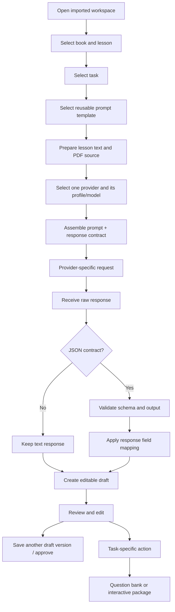

# Edu Mini Generation Studio — Functional, Template and Provider Contract

**Document status:** corrected against the current Android implementation and the accepted design decisions  
**Scope:** Generation Studio, reusable prompt templates, source PDF attachment, response contracts, provider isolation, model fallback, draft persistence and future work.

This document distinguishes three states throughout:

- **Implemented:** verified in the current source tree.
- **Required design:** an accepted architectural rule that must govern future changes.
- **Not implemented / limitation:** a capability that must not be presented as complete.

Primary implementation references:

- `app/src/main/java/com/example/ui/screens/StudioScreen.kt`
- `app/src/main/java/com/example/ui/MainViewModel.kt`
- `app/src/main/java/com/example/data/repository/EduMiniRepository.kt`
- `app/src/main/java/com/example/data/ai/AiGenerationService.kt`
- `app/src/main/java/com/example/data/ai/ProviderRoutingPolicy.kt`
- `app/src/main/java/com/example/data/ai/GeminiModelRouter.kt`
- `app/src/main/java/com/example/data/ai/Indexer2PromptRegistry.kt`
- `app/src/main/java/com/example/data/ai/TemplateResponseAdapter.kt`
- `app/src/main/java/com/example/data/ai/TemplateOutputValidator.kt`
- `app/src/main/java/com/example/data/security/ProviderStorage.kt`
- `app/src/main/java/com/example/data/local/EduMiniDatabase.kt`
- `app/src/main/java/com/example/model/Models.kt`

---

## 1. Product responsibility and boundaries

Generation Studio is the lesson-aware authoring workspace. It receives an already identified lesson from the imported workspace and generates editable educational content against that lesson's source material.

The Studio is responsible for:

1. selecting the workspace lesson and generation task;
2. selecting and applying a reusable prompt template;
3. preparing the lesson source text and/or PDF attachment;
4. selecting one AI provider and one of that provider's configured profiles/models;
5. assembling the prompt and the template response contract;
6. submitting the request through the selected provider path;
7. validating and adapting the response;
8. saving an editable draft with provenance;
9. exposing task-specific follow-up actions, such as saving questions or building an interactive package.

The Studio is **not** responsible for re-indexing the source book, changing the workspace's canonical index, or creating a permanent lesson JSON snapshot.

### Source-of-truth boundaries

- Workspace `index.json` and `book_manifest.json` remain authoritative for book, unit, lesson, part and page identity.
- The selected lesson PDF remains the primary document source for generation when attached.
- Prompt templates define reusable generation instructions and output contracts.
- The provider response is untrusted until validated and adapted.
- A generated draft is application-owned content; it does not overwrite the imported workspace.
- A future persistent lesson text/JSON snapshot is a separate, deferred feature. It must not be silently introduced as a side effect of generation.

## 2. End-to-end Studio workflow



A request must have a selected lesson and at least one usable source: non-empty source text or an enabled, readable lesson PDF attachment. The UI must not submit an empty-source request.

The selected provider is captured for the request. Changing the default provider affects subsequent requests, not a request already in progress.

## 3. Lesson context, post-segmentation extraction and source selection

### 3.1 Pipeline boundary: extraction happens after lesson segmentation

The source-processing lifecycle has distinct stages:

1. **Book segmentation:** identify unit/lesson boundaries and create a separate PDF file for each lesson.
2. **Lesson source preparation:** process each lesson-level PDF to produce an optional text sidecar.
3. **Generation Studio:** select the lesson and choose which available representation to send with the generation prompt.
4. **Provider transport:** encode the selected representation in the format supported by the chosen provider.

Text extraction is therefore a **post-segmentation preparation stage**, not part of book segmentation and not an implicit side effect of every Generation Studio request.

The intended workspace relationship is:

- `lesson_XX.pdf`: the segmented source PDF for one lesson;
- `lesson_XX.txt`: optional extracted text for that same lesson;
- `lesson_XX.extraction.json`: optional extraction metadata/provenance;
- `index.json`: canonical lesson identity and references such as `pdfPath` and `sourceTextPath`.

The PDF is the primary source artifact. The TXT file is a derived, optional representation. It must never replace the PDF or become the authority for lesson identity/page boundaries.

### 3.2 Lesson extraction methods

The extraction process operates on the already segmented lesson PDF, not the original whole-book PDF.

The supported design should allow these methods:

1. **Embedded PDF text extraction:** use the PDF's existing text layer when it is present and sufficiently complete. This is preferable to OCR for born-digital PDFs because it avoids recognition errors.
2. **OCR extraction:** for scanned/image-only pages or pages whose embedded text is missing/unusable, run OCR with both Arabic and English language support. Preserve reading order, page boundaries, Arabic shaping/direction, and mixed Arabic/English passages. Record OCR engine/language configuration and confidence or quality indicators.
3. **AI-assisted transcription:** optionally send the lesson-level PDF to a vision-capable AI model with a dedicated *verbatim transcription* prompt and request the lesson text, preserving headings, paragraphs, lists, tables and page markers. This is an extraction operation, not the later educational generation task (summary, explanation, questions, etc.).

**Recommended extraction policy:** inspect the embedded text layer first; use OCR for scanned or poor-text pages; offer AI-assisted transcription as an explicit alternative or recovery path when OCR quality is inadequate or page layout is complex. Do not silently replace low-confidence OCR with AI output. AI transcription can omit, normalize or hallucinate text, so it must be checked against the PDF and marked as AI-derived.

Do not combine OCR and AI outputs by blindly concatenating them. If both are run for quality comparison, retain separate candidates and require a deterministic selection/review step to avoid duplicated or conflicting paragraphs.

The extraction stage should produce one chosen text artifact per lesson, with a clear method and provenance. It should not summarize, simplify, generate questions, or rewrite the educational content. Those are separate Generation Studio tasks.

### 3.3 Verified current implementation and integration gaps

The inspected code confirms some foundations, but not the complete extraction workflow:

**Workspace segmentation**
- `PdfBookSplitter` creates separate lesson-level PDF files from page ranges.
- It writes a `sourceTextPath` reference such as `lesson_XX.txt` into the workspace index.
- It also accounts for a possible `.extraction.json` sidecar when reporting existing split files.
- Writing the expected `sourceTextPath` into the index does not itself create the extracted TXT file. A missing sidecar must remain an absent optional artifact, not be treated as an extraction success.

**Current text extraction in Indexer2**
- `server/index.ts` contains `extractPdfText()`, which reads the embedded PDF text layer page by page using PDF.js.
- It adds physical PDF page markers and stops at a default maximum of 80,000 characters.
- `readLessonSources()` calls it for a resolved lesson PDF and also reads/Base64-encodes that PDF for Indexer2's own server-side AI workflow.
- This function does not perform OCR for image-only pages, does not itself create a durable `.txt` sidecar, and does not expose a complete per-page extraction-quality/truncation contract.
- It does not apply the lesson's `pdfPageStart`/`pdfPageEnd` values itself. In the intended post-segmentation workflow, it should receive the already sliced lesson PDF; it must not silently be given a whole-book PDF and assumed to know lesson boundaries.

**Current Android workspace reading**
- `LessonRef` has an optional `sourceTextPath`.
- `StudentStudyDialog` reads the referenced text file when it exists and can fall back to sibling `.txt`/`.md` files for displaying lesson content.
- This proves that the workspace can carry and display an extracted text sidecar. It does not prove that Generation Studio consumes that file.

**Current Generation Studio behavior**
- The Studio currently exposes an editable `sourceText` field and a PDF-attachment checkbox.
- The PDF checkbox defaults to enabled.
- The generation path uses the text entered/provided in `sourceText`; it does not currently load `lesson.sourceTextPath` as the default generation text source.
- If source text is present while PDF attachment remains enabled, the current request can send both the text and the PDF/page images.
- If source text is empty but PDF attachment is enabled, the request can still proceed using the PDF.
- Therefore the current UI is not yet the required mutually exclusive `PDF` / `EXTRACTED_TEXT` source selector, and it does not automatically fall back from a missing TXT sidecar to a selected PDF mode. This is a concrete implementation gap, not merely a documentation issue.

### 3.4 User-facing source selection and default behavior

The user-facing source choice must be independent of provider transport and prompt-template response schemas.

Use exactly these conceptual choices:

| Choice | Definition | Availability |
|---|---|---|
| `PDF` | Send the segmented lesson PDF as the source input alongside the prompt. | Always the default when a valid lesson PDF exists. |
| `EXTRACTED_TEXT` | Send the extracted lesson text file (`sourceTextPath`) as text alongside the prompt. | Offer only when the referenced text file exists, is readable and passes basic completeness checks. |

Required behavior:

- **PDF is the default source mode**, including when a TXT sidecar exists, unless the user explicitly selects `EXTRACTED_TEXT`.
- If the TXT file is absent, empty, unreadable or invalid, disable `EXTRACTED_TEXT` and use PDF. Do not show an empty text option or submit a blank source.
- If the TXT file exists, show the user that it is the extracted lesson text and allow the user to choose it.
- Choosing `EXTRACTED_TEXT` sends the text file content and does not attach PDF/image pages in the same request.
- Choosing `PDF` sends the lesson PDF and does not also send the TXT content by default.
- Keep manually entered supplementary instructions separate from the source artifact. If manual source editing is retained, label it as an explicit override/edited source, not as if it were the canonical extracted TXT file.
- If neither a valid PDF nor a valid extracted text file exists, block generation and explain what is missing.
- Record the selected mode and the actual source artifact/hash in the draft provenance and request fingerprint.

The current Room field `source_attachment_mode` is stored on the template, but the user's source choice is request-specific. Do not let a prompt template silently force PDF versus text. Treat the existing field as a legacy provider-attachment setting during migration; introduce a request-level source mode and deprecate the template-level source choice deliberately rather than overloading one field with two meanings.

### 3.5 Provider transport for the selected source

Provider differences are transport details, not differences in the meaning of the user's choice.

| User-selected source | Gemini transport | OpenAI-compatible transport |
|---|---|---|
| `PDF` | Prefer the original segmented lesson PDF as an `application/pdf` input part when supported by the selected model/profile. | Render pages from the segmented lesson PDF as image input parts for vision-capable endpoints. Do not assume universal native-PDF support across compatible endpoints. |
| `EXTRACTED_TEXT` | Send the TXT content as text with the prompt. | Send the TXT content as text with the prompt. |

Current Android provider transport:
- Gemini supports the original PDF as `application/pdf` inline data in `pdf_native` mode, and rendered JPEG page images in `rendered_pages` mode.
- OpenAI-compatible requests currently use rendered JPEG page images when PDF attachment is enabled.
- The OpenAI-compatible renderer currently samples up to four pages distributed across the referenced PDF. This is not equivalent to sending every page and must not be described as full-document delivery.
- The current PDF attachment limit for the native Gemini path is 18 MiB.
- When the lesson reference points to a correctly segmented lesson PDF, the entire lesson PDF is the intended input. If it points to a whole-book PDF, the current native Gemini path can attach the whole book; this must be prevented by workspace validation or corrected before dispatch.

**Terminology:** rendered JPEG pages are images sent *to the model as source input*. They are not images returned by the model. Generated image output is a separate response modality and task contract.

Printed page numbers and physical PDF page numbers are different coordinate systems. Since this stage runs after segmentation, the lesson PDF itself should be the bounded source. Retain the original book page range only as metadata; do not re-slice the lesson PDF using printed page numbers.

### 3.6 Extraction artifact contract

Indexer2 should own the canonical extraction implementation and expose its result to the workspace/Android importer through a stable, versioned artifact contract. Do not implement a second competing PDF-to-text algorithm inside Generation Studio.

The extraction metadata should include at least:

- workspace/book/unit/lesson identity;
- lesson PDF relative path and SHA-256;
- extraction artifact path and text SHA-256;
- extraction method (`embedded_text`, `ocr`, or `ai_transcription`), including per-page method if mixed;
- language configuration (Arabic, English, or both);
- page count and page markers;
- OCR confidence/quality indicators where available;
- completeness/coverage and whether any content was truncated;
- extraction tool/model and version;
- extraction prompt version/hash for AI transcription, without storing provider secrets;
- extraction timestamp and artifact schema version;
- review status when quality is below the configured threshold or AI transcription was used.

The processing order should be:

1. Confirm segmentation is complete and reviewed; identify the separate lesson PDF.
2. Validate the lesson PDF and compute its SHA-256.
3. Inspect the embedded text layer and measure whether it is usable.
4. Extract embedded text where adequate; run Arabic+English OCR on pages needing recognition.
5. If the user/operator selects AI-assisted transcription or OCR quality is inadequate, send only that lesson PDF with the dedicated transcription prompt. Validate that the returned text covers the expected pages and preserves page markers.
6. Compare quality/completeness signals; retain the selected candidate and mark review needs. Never label a truncated/low-confidence result as complete.
7. Save the chosen lesson text as the optional `.txt` sidecar and extraction metadata as `.extraction.json`, then update/verify the workspace reference.
8. Generation Studio reads the TXT sidecar only when the user selects `EXTRACTED_TEXT`; otherwise PDF remains the default source.

The TXT sidecar is a derived, regenerable artifact. It does not become a permanent canonical lesson JSON snapshot, does not replace the PDF, and does not rewrite the canonical lesson identity in `index.json`.

### 3.7 Privacy and quality boundaries

- Text sent to a provider must pass the text privacy policy. This does not redact personal information embedded in PDF pages or images.
- The UI must disclose which representation will be sent to the selected external provider.
- AI-assisted transcription is itself an external AI request and may incur provider cost. It must be a separately identifiable operation from lesson explanation/question generation.
- Preserve page references so a teacher can compare extracted passages with the original PDF.
- Do not claim OCR or AI transcription is perfectly accurate. For Arabic/English mixed content, verify reading order, punctuation, diacritics where relevant, tables, equations and right-to-left layout.
- Do not silently send both PDF and TXT. A future comparison/debug mode may send both only when explicitly selected and clearly disclosed.


## 4. Prompt templates are the generation contract

### 4.1 Template contents

A reusable prompt template is more than a prompt string. The Room `prompt_templates` record stores:

| Field | Meaning |
|---|---|
| `id` | Stable template identity |
| `title` | User-facing template name |
| `task` | Generation task to which the template applies |
| `instructions` | Reusable task instructions |
| `response_schema_json` | Provider-facing output schema/structure |
| `response_mapping_json` | Mapping from provider field names to application canonical fields |
| `response_format` | `text` or `json` |
| `source_attachment_mode` | Source attachment policy, currently defaulting to `pdf_native` |
| `version` | Template version, incremented when an existing template is edited |

The schema and mapping belong to the template. They must not be duplicated as task-specific hardcoded response bodies inside `AiGenerationService`, `MainViewModel`, or parsers.

The selected template is resolved by its explicit ID first, with a task-compatible template as fallback. The request uses the selected template's instructions, schema, mapping and version.

### 4.2 Built-in and custom templates

- Built-in templates are inserted idempotently into Room from the repository's default template definitions.
- Custom templates are stored in Room and can be edited or deleted.
- Editing an existing template increments its version.
- The prompt blueprint registry provides task-level prompt metadata and asset paths.
- The prompt asset and the persisted template are complementary: the asset provides the base task blueprint; the Room template supplies the reusable selected instructions and response contract.

Current task identifiers:

| Task ID | Purpose |
|---|---|
| `explanation` | Lesson explanation |
| `summary` | Lesson summary |
| `objectives` | Learning objectives |
| `vocabulary` | Vocabulary/glossary |
| `worked_examples` | Worked examples |
| `lesson_review` | Lesson review |
| `difficulty_adapter` | Difficulty adaptation |
| `interactive` | Interactive lesson/activity |
| `questions` | Question bank |

The registry contains task blueprints for these task types. The repository currently seeds a smaller set of built-in prompt-template records; do not assume that every task already has a separate built-in Room template.

### 4.3 Required template behavior

A template must carry its complete response contract alongside its instructions. For structured output, the contract consists of:

1. response format;
2. JSON Schema;
3. response field mapping;
4. template version.

The AI response must be generated dynamically according to the selected template contract. Do not hardcode a fixed response paragraph, fixed question object, or task-specific JSON body in the provider service.

Changing the lesson, task, prompt instructions, schema, mapping, attachment mode, provider or model must be reflected in request provenance.

### 4.4 Template validation

**Implemented:**

- The save path checks that schema and mapping inputs parse as JSON objects.
- Before a JSON generation request, `TemplateOutputValidator` checks the schema structure.
- After the provider responds, the raw JSON is validated against the stored schema before response mapping and draft persistence.
- An invalid provider output is recorded as a validation failure and is not saved as a normal draft.
- The supported validator subset includes object, array, string, number, integer, boolean and null types, object properties/required fields, array items, enum and boolean `additionalProperties`.

**Limitations and required hardening:**

- The validator is a deliberately limited JSON Schema subset, not a complete JSON Schema implementation.
- The current template save path checks JSON-object syntax but does not run the full schema validator before persisting the template.
- The mapping is checked as a JSON object, but its semantic references are not comprehensively validated at template-save time.
- The Settings editor does not currently expose every stored contract field, including a complete response-format and attachment-mode editor.

Before expanding template editing, validate the complete schema and mapping contract before saving. Display field-specific errors and preserve the previous valid template when validation fails. Do not silently downgrade an invalid JSON template to text output.

## 5. Response mapping and canonical application payload

The provider-facing schema and application-facing data model are separate contracts.

Example mapping:

```json
{
  "rootArray": "items",
  "targetArray": "questions",
  "fields": {
    "prompt": "stem",
    "options": "choices",
    "correctAnswer": "answer",
    "rationale": "explanation"
  }
}
```

Meaning:

- `rootArray`: provider's source array name;
- `targetArray`: canonical root array name; defaults to `questions` when omitted;
- `fields`: canonical field name mapped to the provider's field name.

The adapter:

- parses the response when possible;
- adds the canonical root array when a source root array is mapped;
- recursively adds canonical field aliases when the provider's field exists;
- preserves original provider fields;
- does not delete source fields or mutate the stored template.

For an interactive contract, `targetArray` may be `steps`. This adapter is a compatibility layer, not an arbitrary Room schema migration engine. Changes to Room entities or application data semantics still require explicit application code and database migrations.

## 6. Provider isolation

### 6.1 Supported provider types

The current provider enum contains:

- `GEMINI`
- `OPENAI_COMPATIBLE` (user-facing label: OpenAI)

An OpenAI-compatible profile contains its own base URL, API key, model, enabled state, priority and fallback-model list. It must not inherit Gemini model names, keys, cooldown state or provider-specific response assumptions.

### 6.2 Required isolation rule

**A provider failure must never silently switch the request to a different provider.**

If Gemini is selected:

- only enabled Gemini profiles are eligible;
- Gemini model candidates come only from that Gemini profile's primary/fallback model list;
- Gemini-specific request format, PDF handling, error classification and cooldown logic apply;
- OpenAI is not a fallback destination.

If OpenAI-compatible is selected:

- only enabled OpenAI-compatible profiles are eligible;
- only that profile's OpenAI-compatible model list and base URL apply;
- OpenAI-compatible request construction and error handling apply;
- Gemini keys, model candidates and cooldowns are not consulted.

A user who wants to try the other provider must explicitly change the selected provider and start a new request. Provider switching is not an automatic retry policy.

### 6.3 Current code versus desired separation

The current implementation has provider-specific request functions (`callGemini` and `callOpenAiCompatible`) behind a shared `AiGenerationService.generate` dispatcher and a provider-scoped routing policy.

The required architectural direction is to keep the public generation paths explicitly separated as well, for example:

- `generateWithGemini(...)`
- `generateWithOpenAiCompatible(...)`

Each path must own its own profile validation, request assembly, model fallback, retry/error classification, connection test and provider telemetry. Shared code may be limited to provider-neutral preparation such as lesson context, prompt assembly, response validation, mapping and provenance.

This separation is a design requirement; the current shared dispatcher should not be described as two fully independent generation services already implemented.

## 7. Model fallback and overload handling

### 7.1 Configured candidate order

A provider profile stores:

- primary model;
- ordered fallback model IDs;
- `strictModel`.

When strict mode is enabled, only the primary model is attempted. Otherwise the primary model is followed by the configured fallback list, with blank and duplicate entries removed.

Model IDs are configuration, not permanent constants. Examples such as moving from a 3.8 model to 3.7, 3.6 or 3.5 describe a possible user-configured order only. The application must not assume that those model IDs exist, are enabled for a particular key/project, or are still offered by the provider.

The fallback list must remain provider-specific. A Gemini model ID must never be sent to OpenAI-compatible endpoints.

### 7.2 Current Gemini behavior

The current implementation:

1. orders eligible profiles belonging to the selected provider;
2. iterates the primary Gemini model and configured Gemini fallback models;
3. skips Gemini models that are in the process-local cooldown;
4. on HTTP 429, records the affected profile/model cooldown using the provider's `Retry-After` value when available, with a 60-second minimum/default;
5. tries the other configured models on that same Gemini profile;
6. after observing Gemini 429, stops the generation request rather than automatically rotating to another Google key/profile;
7. treats a confirmed quota-exhaustion response differently and stops additional model/profile attempts for that generation;
8. retries transient non-429 failures within a bounded per-candidate retry loop.

The Gemini model cooldown is currently process-local and is lost when the application process restarts. It is model-scoped (profile + model), not a global Gemini cooldown.

### 7.3 Current OpenAI-compatible behavior

OpenAI-compatible profiles use their own configured candidate model list and their own request function. They do not use Gemini cooldown state or Gemini model identifiers.

A provider switch is explicit. A failed OpenAI request must not dispatch Gemini automatically, and a failed Gemini request must not dispatch OpenAI automatically.

### 7.4 Retry policy requirements

For future hardening, keep the failure categories distinct:

| Failure | Required handling |
|---|---|
| Authentication/permission (401/403) | Mark the affected profile invalid/permission-failed; do not retry the same credentials repeatedly |
| Confirmed quota exhaustion | Stop requests that would bypass the provider's quota; show a clear quota message and retry guidance |
| Temporary rate limit / overload (429) | Respect `Retry-After`; apply cooldown to the affected model/profile according to provider semantics; try only configured models within the selected provider |
| Transient server failure (5xx) | Bounded retry with exponential backoff and jitter, then continue only within the selected provider's configured candidates |
| Network/timeout | Bounded retry; preserve the user's prompt and source selection |
| Invalid request/schema/model | Do not repeat an unchanged invalid request; report the precise cause |
| User cancellation | Cancel the active HTTP call and do not continue fallback attempts |

The current code already separates several of these cases, but its retry/backoff policy and Gemini cooldown persistence remain narrower than this target contract. Do not describe the target policy as fully implemented until tests prove each branch.

## 8. Provider profiles, secrets and request telemetry

Provider profiles are encrypted at rest using an Android Keystore-backed key and authenticated encryption. The profile contains the provider type, label, model, endpoint, API key, enabled state, priority, fallback model list, strict-model setting and runtime status.

Rules:

- Never include API keys in prompts, logs, draft provenance, backups or Firestore.
- Mask secrets in the UI.
- Test-connection must test only the selected provider profile and its configured model.
- Runtime status and last-used information may be stored locally.
- The application must not claim that encryption at rest makes an API key impossible to extract from a distributed APK. A public release should use a controlled backend for provider credentials and request dispatch.

### 8.1 Daily request counters

The current `dailyRequestLimit` and `dailyRequestsUsed` fields are not an authoritative local quota gate. `ProviderStorage` explicitly treats the counter as diagnostic telemetry and relies on the provider response for actual quota status. Do not promise that the app enforces a daily request cap until that behavior is deliberately implemented and tested.

Quota date normalization uses each profile's configured timezone. Provider runtime status and `Retry-After` timestamps are retained separately from the prompt-template data.

## 9. Output persistence, editing and task-specific actions

### 9.1 Draft persistence

A successful generation is saved as an application draft in the local Room database. Drafts are versioned per workspace/book/unit/lesson/task context and retain:

- provider label and actual model ID;
- template ID and template version;
- response schema hash;
- request fingerprint;
- generated content hash;
- source PDF hash;
- source page range and source text hash where available.

The generated text remains editable. Saving an edited version creates another draft version; it must not silently overwrite the previous draft. Draft approval is a separate user action.

Full local backup includes the template contract and draft provenance fields. Cloud draft synchronization may carry draft provenance, but provider secrets must never be synchronized.

### 9.2 Task-specific post-processing

- **Questions:** the generated output is saved as a draft and parsed into the question bank when the question task succeeds. Concept tags are retained or inferred by the existing question parsing path where applicable.
- **Interactive lesson:** the output is parsed into the interactive activity model. A valid activity can be built into a student-facing HTML/JS/JSON package. Checkpoint answers should be routed through the interactive question-attempt callback so learning analytics can record them.
- **Other tasks:** the generated result remains an editable lesson draft until the user chooses an available follow-up action.

An interactive package is a task-specific deliverable. It is not the deferred persistent lesson JSON snapshot and must not be conflated with one.

### 9.3 Deferred persistent lesson snapshot

A permanent lesson JSON/text snapshot remains deferred. When implemented later, it should be a separate versioned artifact containing at least:

- workspace/book/unit/lesson identity from the canonical workspace;
- source PDF SHA-256;
- page range;
- extraction method (PDF text layer/OCR/manual);
- extraction timestamp;
- snapshot schema version;
- extracted content hash.

It must be regenerable and auditable, must not rewrite `index.json` or `book_manifest.json`, and must not become an implicit side effect of a normal Studio generation request.

## 10. Provenance and reproducibility

The current request seed includes template ID/version, attachment mode, task, lesson identity, page range, response schema hash, mapping hash, response format, PDF hash, source text and effective instructions. The final request fingerprint additionally includes provider, actual model and assembled prompt.

The generated result and draft retain the relevant hashes and model/template identifiers. API keys are excluded.

**Known limitation:** the current template row is updated in place when edited; the version number increments, but immutable historical copies of every prior template body/schema/mapping are not maintained as separate template revisions. A draft's version and hashes help identify its generation contract, but they do not by themselves reconstruct the exact prior template contents. If exact replay/audit is required, add immutable template revision snapshots or store a complete request-contract snapshot with the draft.

## 11. Error handling and user experience

On failure:

- preserve the selected lesson, source text, prompt instructions, selected template and provider;
- preserve existing drafts;
- show a classified, actionable error instead of a generic "generation failed";
- show which provider and model failed, without exposing secrets;
- distinguish overload/rate limit from quota exhaustion, invalid credentials, invalid model, invalid request, malformed JSON and schema mismatch;
- allow the user to retry after correcting the cause or explicitly selecting another provider;
- never report success before validation and draft persistence complete.

Progress indicators represent real pipeline stages (source preparation, attachment preparation, request dispatch, response validation/adaptation and persistence). They must not imply token-by-token progress when the HTTP provider does not expose it.

## 12. Database and migration contract

The current Room schema stores the prompt-template response contract and generation provenance in addition to the original draft fields.

Migration `15 → 16` adds to `prompt_templates`:

- `response_schema_json`;
- `response_mapping_json`;
- `response_format`;
- `source_attachment_mode`;
- `version`.

It adds to `generation_drafts`:

- `template_id`;
- `template_version`;
- `response_schema_hash`;
- `request_fingerprint`;
- `content_hash`;
- `source_pdf_hash`.

The migration is additive and supplies defaults for existing rows. Release validation must test migration from every supported historical database version to the current version, not merely instantiate a fresh database. The current source includes a 15→16 migration; do not claim a tested 13→16 path unless the migration chain and tests prove it.

Template changes must not erase existing drafts or source workspace records.

## 13. Required tests and acceptance criteria

### Template and response contract
- Add/edit/delete custom templates and preserve their IDs.
- Editing increments the template version.
- Built-in templates are inserted idempotently.
- Invalid schema is rejected before the template is saved.
- Invalid mapping structure or unsupported field references produce actionable validation errors.
- JSON response is validated before adaptation and draft persistence.
- Invalid AI output is recorded as validation failure and is not persisted as a normal draft.
- Field mapping preserves original provider fields while adding canonical aliases.
- Different tasks can use different schemas/mappings without task-specific hardcoded response bodies.

### PDF and source
- Gemini receives the original PDF bytes as `application/pdf` with the prompt.
- OpenAI-compatible receives rendered JPEG page parts with the prompt.
- Attachment disabled means no PDF/image data is sent.
- Invalid, missing, oversized or unreadable PDFs fail before provider dispatch.
- PDF attachment privacy notice is visible and accurate.
- Source PDF hash is stable across repeated reads of the same bytes.

### Provider isolation and fallback
- Gemini failure never dispatches OpenAI-compatible.
- OpenAI-compatible failure never dispatches Gemini.
- Candidate model order follows the selected profile configuration.
- Strict model mode attempts only the primary model.
- Gemini 429 cooldown affects the relevant model/profile and does not silently rotate Google keys.
- Confirmed quota exhaustion stops prohibited retries.
- OpenAI-compatible model candidates are independent of Gemini models and cooldown state.
- Provider switching affects new requests only.
- Cancellation stops the active HTTP request.

### Persistence and learning integration
- Draft provenance is saved and included in full local backup/restore.
- Editing creates a new draft version.
- Question parsing retains or infers concept tags without overwriting explicit valid tags.
- Interactive checkpoints invoke the answer callback and record attempts against the correct lesson/concept.
- Room migration tests cover every supported historical version through the current version.

---

## 14. Explicit non-goals

The following must not be silently folded into the current Generation Studio contract:

- automatic cross-provider fallback;
- automatic permanent lesson JSON snapshot creation;
- rewriting canonical workspace indexes or lesson PDFs;
- treating a prompt example as a validated JSON Schema;
- assuming all OpenAI-compatible endpoints support identical PDF or strict JSON Schema features;
- claiming local daily quota enforcement when the provider is authoritative;
- claiming that a configured model preset is available for every API key/project;
- treating an interactive student package as the canonical lesson source.

