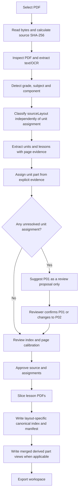

# Indexer2 Workspace Preparation Algorithm

## 1. Responsibility boundary

This document describes the producer contract that Edu Mini consumes. Indexer2 owns PDF discovery, curriculum identity, source-layout classification, unit-part assignment, index review, page calibration, lesson slicing, file paths, manifests and hashes.

Edu Mini must consume the prepared workspace. It must not duplicate the PDF classifier, infer part assignments, rebuild lesson paths when `sliceFile.workspaceUri` exists, or slice the source PDF again.

The Indexer2 implementation is the authority for actual behavior. Where this document describes the target layout not yet implemented, the status is explicitly marked below.

## 2. End-to-end preparation sequence



A proposal must never be silently converted into a confirmed assignment. The approval gate must reject unresolved units.

## 3. Source layout and unit assignment are separate

### 3.1 `sourceLayout`

- `SINGLE_PART_FILE`: the uploaded PDF is one independent part.
- `MERGED_PARTS_FILE`: the uploaded PDF is one source containing both parts.
- Unknown or conflicting evidence remains under review; it must not be converted to a single-part source merely because the TOC is unclear.

### 3.2 Unit assignment

For each unit, preserve:
- confirmed `partKey` or `unknown`;
- `assignmentStatus`;
- optional `proposedPartKey`;
- `assignmentEvidence`.

Automatic assignment requires explicit source evidence such as a TOC section, unit title/heading evidence or a verified standalone-source part. Unit number alone is never evidence.

For an unresolved unit in a confirmed merged source, Indexer2 may propose P01 as a default review suggestion. The UI must display the proposal and require an explicit reviewer action to confirm P01 or choose P02. Until that action, keep `partKey=unknown`, `assignmentStatus=NEEDS_REVIEW`, and keep the source `sourceLayout=MERGED_PARTS_FILE`.

A manual decision must be recorded as reviewer provenance. A confirmed proposal must not be recorded as automatic evidence.

## 4. Workspace layout

### 4.1 Independent single-part PDF — target layout

For a P01 source:

```text
workspace/<gradeKey>/<subjectKey>[/<componentKey>]/
  P01/
    index.json
    book_manifest.json
    cover.png
    units/<unit-folder>/lesson_<nn>.pdf
```

For P02, use the P02 directory. No root `index.json` is written for an independent source. The part-local manifest carries that source's `sourceSha256` and canonical index path/hash.

### 4.2 One merged PDF — target layout

```text
workspace/<gradeKey>/<subjectKey>[/<componentKey>]/
  index.json
  book_manifest.json
  cover.png
  P01/
    index.json
    cover.png
    units/...
  P02/
    index.json
    cover.png
    units/...
```

The root index is the one canonical complete index. Part indexes are derived filtered views. They retain the merged source identity and must never be treated as independent books.

### 4.3 Merged source requiring assignment review

The root index and root manifest remain the review package. Unresolved units remain in the root index with a separate proposal and provenance. Do not write final derived part indexes or lesson slices until all required assignments are explicitly confirmed.

## 5. Canonical identity and display values

Use `gradeKey`, `subjectKey`, and optional `componentKey` as stable identity. The Arabic display names in the prepared index (`displayName`, `subjectName`, and `componentName`, when provided) are the preferred labels for UI presentation. Consumers may use a local catalog only as a fallback. Never derive a canonical key from a display name.

## 6. Lesson file references

Each sliced lesson must carry a workspace-relative `sliceFile.workspaceUri` that resolves to the exact generated PDF. This path is authoritative for consumers. Paths must be normalized and constrained to the workspace root.

Consumers should use that explicit reference directly. Reconstructing `P01/units/unit_01/lesson_01.pdf` from numbers is only a legacy fallback for old packages with no explicit path.

## 7. Manifest and hashes

The current exporter writes one `indexSha256` for the root index. The target exporter must declare:
- `canonicalIndexPath`;
- `canonicalIndexSha256`;
- `partIndexes` containing each derived path and its hash, where applicable;
- `sourceSha256`, source layout, source review status, identity keys and export counts.

For a standalone source, the canonical index is `P01/index.json` or `P02/index.json`. For a merged source, it is root `index.json`. Hashes are calculated from the exact serialized bytes written to each file.

## 8. Current implementation status (verified snapshot)

The current Indexer2 code has these behaviors:
- `sliceBookLessons` requires each unit to have P01/P02 and writes lesson files under the unit's part folder.
- The workspace exporter always writes root `index.json`.
- It writes `P01/index.json` and/or `P02/index.json` only for merged sources, as filtered views.
- The manifest currently has one root `indexSha256`; it does not yet declare the canonical path and a hash for every part index.
- The shared `Unit` TypeScript interface currently has `partKey`, but does not declare the assignment-status/proposal/evidence fields described in the target contract.
- The intake UI already has a per-unit P01/P02 selector for merged books, but the current handler records only `partKey`; it does not preserve assignment provenance or distinguish an explicit human confirmation from automatic assignment.
- The current review gate blocks units with unknown part keys, but there is no separately persisted P01 proposal requiring confirmation.

Therefore the target contract is not yet fully implemented in Indexer2. These gaps must be fixed in the type, intake UI, slicing/exporter, manifest, API/schema where the index is persisted, and tests before claiming full compatibility.

## 9. Consumer requirements for Edu Mini

Edu Mini must:
1. discover root and part-local index files;
2. pair each canonical index with the manifest beside it;
3. classify a part-local standalone index separately from a merged derived view;
4. bind a merged root index exactly once and not create duplicate books from its derived indexes;
5. verify every declared hash against its own file;
6. use index-provided display labels when present, with local catalog fallback;
7. resolve lessons from `sliceFile.workspaceUri` first;
8. preserve legacy workspace import support without letting legacy fallbacks override valid explicit references.

## 10. Non-negotiable invariants

- Unclear TOC evidence never changes a merged source into a standalone source.
- P01 proposal is not confirmed assignment.
- A standalone source has a part-local canonical index.
- A merged source has one root canonical index; part indexes are derived.
- Each source PDF has its own source SHA-256.
- Each index hash belongs to the exact index file it describes.
- The application consumes Indexer2's workspace; it does not reimplement its indexing logic.
