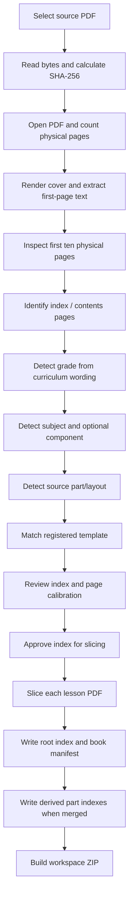

# Indexer2 Workspace Preparation Algorithm

## 1. Scope and source of truth

This document describes the implemented Indexer2 PDF intake, identity detection, template selection, lesson slicing, and ZIP workspace export flow. It is based on the Indexer2 implementation, not on an assumed or reconstructed workflow.

Primary implementation references:

- `indexer2/src/shared/services/pdfService.ts`
- `indexer2/src/shared/data/templateRegistry.ts`
- `indexer2/src/shared/types/index.ts`
- `indexer2/config/prompts/workspace_builder.md`

The prepared workspace is a content package. The Android application consumes it; it does not repeat PDF indexing or lesson slicing.

## 2. End-to-end sequence



The order is significant: template matching and detection provide candidates; review and approval are gates before slicing. A key or page range that is not established by evidence must remain unresolved rather than be filled by a default.

## 3. PDF intake and evidence extraction

### 3.1 Source file and physical pages

`discoverBook(file, registeredTemplates, options)` reads the uploaded PDF bytes, starts SHA-256 calculation, opens the document through PDF.js, and obtains the physical page count.

Default discovery settings in `DiscoveryOptions`:

- Cover page: physical PDF page 1.
- Index scan range: physical PDF pages 3–10.
- Initial page inspection: up to the first 10 physical PDF pages.
- OCR pages already recognized by intake may be supplied through `precomputedOcrPages`.
- `onPageProgress` reports each extracted page and its OCR metadata.

Physical PDF page numbers and printed page numbers are separate coordinate systems. The index stores printed ranges; slicing converts those ranges to physical PDF pages using the reviewed offset.

### 3.2 Text extraction and OCR

The discovery process extracts searchable text from PDF.js page text content. It can reuse OCR text supplied through `precomputedOcrPages`. The result records whether OCR was used and its confidence when available.

The cover is rendered as an image for review and identity evidence. The discovery result retains page-level text snippets, character counts, detected index pages, and evidence logs.

### 3.3 Identity text normalization

Identity matching normalizes Unicode text, Arabic diacritics and tatweel, common Arabic letter variants, Arabic-Indic digits, directional marks, and whitespace. This normalization is applied to evidence matching; it does not authorize inventing internal keys from arbitrary metadata strings.

## 4. Grade, subject, and component detection

### 4.1 Grade

`detectGrade(text)` matches curriculum wording against the configured grade rules and returns:

- `value`: canonical Arabic grade label;
- `key`: canonical grade key G01–G12;
- `evidence`: the matching phrase.

The detector intentionally does not treat internal registry/file keys as positive evidence in the PDF. Short ordinal forms for grades 7–9 are accepted only in the explicit book-title patterns implemented in the function.

### 4.2 Subject

`detectSubject(text, gradeKey)` first checks the explicit subject rules. If those do not match, it checks generic-science wording:

- Generic science maps to `SCI` for basic grades G01–G09.
- Generic science does not map to `SCI` for secondary grades G10–G12.
- Secondary science subjects are identified through their explicit subject wording.

The function returns an empty key when evidence is insufficient. A caller must not replace an empty result with a guessed subject.

### 4.3 Social-studies component

When the detected subject is `SOC`, `detectSocialComponent` recognizes the explicit component evidence:

- `GEO`: geography;
- `HIST`: history;
- `TARBIA`: national education.

A component is optional when the book is a general social-studies book. The component does not replace `subjectKey=SOC`.

## 5. Part and source-layout detection

The algorithm separates the physical source-file layout from the part assignment of individual units.

- `SINGLE_PART_FILE`: one source PDF represents one book part.
- `MERGED_PARTS_FILE`: one source PDF contains units assigned to both P01 and P02.
- `UNKNOWN_REVIEW`: the evidence is insufficient or conflicting and requires review.

The template-level `partKey` may be `P01`, `P02`, or `BOTH`. For a merged book, each unit retains its own `partKey` of P01 or P02. A unit whose part cannot be established must not be sliced until reviewed.

The source-layout decision and unit-level part assignment are distinct decisions. A global mention of both semesters is not a substitute for unit-level evidence.

## 6. Template registry and matching

`templateRegistry.ts` discovers modules dynamically from:

`src/shared/data/templates/G*/*.ts`

A template is accepted only when its exported object and file path agree on:

- grade folder and `gradeKey`;
- subject segment and `subjectKey`;
- optional component segment and `componentKey`;
- part suffix and `partKey`;
- `templateName` matching the canonical filename.

The canonical filename pattern is:

`<SUBJECT_KEY>[_<COMPONENT_KEY>]_<GRADE_KEY>_<P01|P02|BOTH>.ts`

The registry does not define a hardcoded matrix of every possible grade/subject combination. The available combinations are the templates discovered in the repository at runtime.

`matchTemplateDirectly` and the discovery result expose matched, suggested, and candidate templates. A suggested template is not the same as an approved index.

## 7. Index review and page calibration

The selected template contains unit and lesson titles and printed-page boundaries. Review must verify the identity, part assignment, and page mapping against the actual source PDF.

In `IndexTemplate`, a lesson has:

- `printedPageStart`, `printedPageEnd`;
- optional `pdfPageStart`, `pdfPageEnd`;
- `contentType` and optional descriptive fields;
- optional `sliceFile` after slicing.

The slicing implementation currently computes the physical PDF range from the printed range and template offset:

```ts
pdfStart = lesson.printedPageStart + offset;
pdfEnd   = lesson.printedPageEnd + offset;
```

It validates integer bounds and ensures the end page does not exceed the source PDF page count. The current slicing code does not use the optional `lesson.pdfPageStart` / `lesson.pdfPageEnd` values for this calculation. Therefore those fields must not be documented as the active slicing inputs.

## 8. Lesson slicing

`sliceBookLessons(file, template, onProgress)`:

1. Reads the source PDF and calculates its SHA-256.
2. Loads the source PDF and counts pages.
3. Extracts the cover image from the source PDF.
4. Iterates through every lesson in every unit.
5. Requires each unit to be assigned to P01 or P02.
6. Converts printed page ranges to physical PDF page ranges using the template offset.
7. Rejects invalid or out-of-bounds page ranges.
8. Creates one PDF per lesson and records its filename, workspace-relative path, byte size, page count, and physical page boundaries.

The unit number is padded for the unit folder and lesson number for the lesson filename. A merged book uses the unit's own part assignment to place the lesson under the appropriate part directory.

## 9. Workspace ZIP generation

`downloadPythonWorkspaceZip(template, slices, coverImageDataUrl, sourceFile)` writes the canonical workspace root:

`workspace/<gradeKey>/<subjectKey>[/<componentKey>]/`

It writes:

- `index.json`: serialized root template; canonical index.
- `book_manifest.json`: companion source and index metadata.
- `cover.png`: optional cover image.
- `validation_report.json`: slicing/export validation summary.
- `manual_review/slice_approval_index.json`: approval record associated with source and index hashes.
- Lesson PDFs at their `workspaceRelPath` locations.

For a merged book, the exporter may write `P01/index.json` and/or `P02/index.json` when that part has units. These are filtered views derived from the root index. They are not independent canonical indexes.

### 9.1 Manifest fields written by the exporter

The current exporter writes:

| Field | Meaning |
|---|---|
| `manifestVersion` | Manifest contract version (`edu.book_manifest.v1`) |
| `bookTitle` | Template title |
| `gradeKey`, `subjectKey`, `componentKey` | Canonical curriculum identity |
| `partKey`, `sourceLayout` | Template part and source layout |
| `sourceReviewStatus` | Review status |
| `sourceFileName` | Original PDF filename |
| `sourceSha256` | SHA-256 of original PDF bytes |
| `indexSha256` | SHA-256 of serialized root `index.json` |
| `totalLessons`, `unitsCount` | Export counts |
| `offset` | Printed-to-physical page offset used by slicing |
| `coverImagePaths`, `partIndexPaths` | Relative paths of cover and derived part indexes |
| `createdAt` | Export timestamp |

## 10. Required invariants

- A grade key must be one of G01–G12 and must be supported by explicit source evidence or the canonical workspace path.
- A subject key must be one of the canonical Indexer2 subject keys and must be established by source evidence or the canonical workspace path.
- An unknown subject or grade is unresolved; it is not replaced by a default.
- `SOC` remains the subject key when a social component is present.
- A component key must be established by the detector or a canonical template.
- Unit part assignment must be P01 or P02 before slicing.
- Printed page numbers and physical PDF page numbers must not be conflated.
- The root `index.json` is the canonical index; part indexes are derived.
- `sourceSha256` identifies source PDF bytes; `indexSha256` identifies the serialized canonical index.
- The Android binder validates and consumes the prepared workspace. It does not rerun Indexer2 discovery or slicing.
