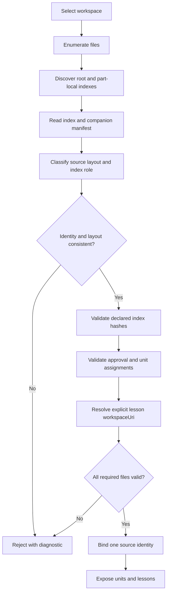

# Workspace Binding and Import Contract

## 1. Responsibility boundary

**ai_books owns the complete content-authoring and workspace lifecycle.** The administrator device prepares and approves the curriculum locally; student devices consume grade-scoped content packages. No runtime, schema, API, database, or operational dependency on Indexer2 is permitted.

ai_books is responsible for the full lifecycle:
- ingesting the selected source PDF temporarily, extracting/reviewing the TOC, and approving the index;
- assigning stable book/unit/lesson identities and page ranges;
- slicing lesson PDFs and producing any approved lesson text/HTML assets;
- persisting the canonical approved index and learning content metadata in Room;
- maintaining the administrator Workspace and producing portable grade packages.

The student app validates and imports a grade package, stores its lesson files locally, and binds them to the canonical curriculum records in its own Room database. It must not depend on the administrator device's absolute paths or content URIs.

## 2. Workspace root and index placement

The logical curriculum root is:

`workspace/<gradeKey>/<subjectKey>[/<componentKey>]/`

The placement of `index.json` depends on the verified source layout. The path alone does not change source identity.

### 2.1 Independent single-part PDF

An independent PDF contains one part only. Its index and companion manifest live inside that part directory:

```text
workspace/G07/ENG/COURSE/
  P01/
    index.json
    book_manifest.json
    cover.png
    units/...
```

For a P02 source, use `P02/index.json` and `P02/book_manifest.json`. Do not require or synthesize a root `index.json` for this layout. Each independent PDF has its own source SHA-256 and source identity.

### 2.2 One merged PDF containing both parts

A merged PDF is one source and one logical book identity. Its root index is canonical; part indexes are filtered views, not separate books:

```text
workspace/G07/ENG/COURSE/
  index.json
  book_manifest.json
  cover.png
  P01/
    index.json
    cover.png
    units/...
  P02/
    index.json
    cover.png
    units/...
```

The root index contains the complete unit list. Each part index contains only units assigned to that part. Edu Mini binds the root index once and must not create duplicate books from its derived part indexes.

### 2.3 Merged PDF with unresolved unit assignments

The source remains `MERGED_PARTS_FILE`. An unclear TOC does not convert it into a single-part PDF.

Keep the source as `MERGED_PARTS_FILE` in the intake/review state. Do not export a final workspace, root manifest, derived part indexes, or lesson slices while any required assignment remains unresolved. For an unresolved unit:
- keep the actual `partKey=unknown`;
- an optional `proposedPartKey=P01` is only a proposal;
- record `assignmentStatus=need_review` and `assignmentSource=DEFAULT_PROPOSAL`;
- keep the evidence/proposal explanation in `assignmentEvidence`;
- do not promote the proposal until a reviewer explicitly selects P01 or P02.

A P01 proposal must never be silently promoted to a confirmed assignment.

## 3. Identity and display metadata

The canonical identity fields are `gradeKey`, `subjectKey`, and optional `componentKey`. They are validated against the app-owned curriculum catalog and the package metadata/path.

Display labels are presentation data:
- use a non-empty `displayName` / `subjectName` / `componentName` declared by the prepared index when available;
- otherwise use the Android catalog as a fallback;
- never use a display label to derive or replace a canonical key.

The same rule applies to grade labels. Unknown or inconsistent canonical keys remain blocking errors; a display string cannot repair them.

## 4. Discovering workspaces

The binder/importer must discover both supported index locations:
- root index: `<bookRoot>/index.json`;
- part index: `<bookRoot>/P01/index.json` or `<bookRoot>/P02/index.json`.

Classification is based on the index and companion manifest fields, not folder name alone:
- `sourceLayout=SINGLE_PART_FILE` plus a part-local index/manifest is one independent source;
- `sourceLayout=MERGED_PARTS_FILE` plus a root index/manifest is one merged source;
- a merged part-local index is a derived view and must be associated with its root merged source, never imported as an independent source.

Reject ambiguous or contradictory combinations rather than guessing.

## 5. Index and manifest integrity

The manifest must identify the source PDF using `sourceSha256`. Hashes identify exact serialized index bytes:
- independent part: the part-local `index.json` hash;
- merged source: the root `index.json` hash, plus hashes for each exported part view when present.

The exporter must declare the exact relative index paths and hashes in the manifest. The consumer verifies every declared file against its own hash. It must not compare a part index with the root index hash.

For backward compatibility, the consumer may read the legacy root-index manifest contract when its fields and hash validate. Compatibility must not weaken validation of new packages.

## 6. Lesson file resolution

Resolve lesson PDFs in this order:
1. if `sliceFile.workspaceUri` is present, normalize and resolve only that declared workspace path (including deterministic path-root normalization); if it is unsafe, missing or unreadable, reject the lesson reference and do not fall back to another filename;
2. only when `workspaceUri` is absent, inspect older explicit relative path fields declared by the legacy schema;
3. only for older packages with no explicit path fields, use the legacy path convention.

Normalize and validate paths to prevent traversal outside the selected workspace. Confirm the referenced file exists, is readable as a PDF, and belongs to the lesson record being imported. Do not substitute another lesson file.

Do not infer the PDF path from unit number, lesson number, or part folder when a valid `workspaceUri` exists.

## 7. Unit and lesson identity

Use stable unit/lesson identifiers from the index when present. Otherwise derive compatibility keys from source numbers, including the part context where duplicate unit numbers can occur in a merged source.

Array order is not identity. A part view is not a second book identity. Duplicate source unit numbers across P01/P02 are valid only when their source identifiers and part context distinguish them. For manifest v2, a final unit assignment requires `assignmentStatus=assigned`, `assignmentSource=INDEX_EVIDENCE` or `REVIEWER`, and non-empty `assignmentEvidence`.

## 8. Binding sequence



## 9. Grade content package for student devices

The distribution unit is a **grade-scoped content package**, not a copy of the administrator's full database. The package is generated from the approved Room curriculum and contains:
- grade/package metadata and a stable package ID/version;
- stable book, unit, and lesson keys plus the minimum metadata needed to bind each file to its Room record;
- lesson PDFs and all required local assets (including HTML/interactive assets when used);
- relative file paths, byte sizes, SHA-256 hashes, and a package manifest;
- optional approved question/assessment content only when that content is intended to be distributed to learners.

The package does not contain the administrator's private drafts, API credentials, local settings, unrelated grades, or learner performance history. The canonical index remains in Room; package metadata is a binding/transport projection, not a second editable source of truth. On import, the student app validates the package, installs files into app-managed local storage, then binds them to local Room records. Lesson viewing resolves the local file by stable lesson identity and a validated relative path, never by a path copied from the administrator device.

Suggested logical layout (names are illustrative and must be reconciled with the existing folder contract before implementation):

```text
grade-package.zip
  package_manifest.json
  grade_metadata.json
  books/<bookKey>/book_metadata.json
  books/<bookKey>/units/<unitKey>/lessons/<lessonKey>/lesson.pdf
  books/<bookKey>/units/<unitKey>/lessons/<lessonKey>/content.json
  books/<bookKey>/units/<unitKey>/lessons/<lessonKey>/interactive/...
  assets/...
```

Import must be staged and atomic at package level: verify ZIP paths, grade identity, schema/version compatibility, required files, sizes and hashes before making the package active. A failed import must leave the previously installed package and learner records intact. Re-import/update must preserve stable lesson identities and learner progress; removed lessons require an explicit retention/archive policy, not silent deletion.

## 10. Current implementation status versus target contract

The Android implementation has now been updated toward this contract:
- the direct binder discovers root and part-local indexes; a part-local index is accepted as an independent source only with its local manifest, while a merged derived view is skipped when its root index exists;
- the ZIP importer applies the same rule and keeps the P01/P02 suffix in the independent source identity without treating it as a component key;
- the validator checks the canonical index hash/path and verifies every declared merged part-index path and SHA-256;
- a declared `sliceFile.workspaceUri` is authoritative. If it is unsafe or cannot be resolved, the consumer does not silently reconstruct a different lesson path; legacy reconstruction is reserved for packages with no explicit URI;
- the importer and binder prefer the index-provided `subjectName` for display, with the Android mapper as fallback.

Tests have been added for standalone part-local import/binding, merged derived-index hash validation, and explicit URI precedence. The repository test suite and Android build have not been run in this work session; do not treat code changes as test-passing until those commands run successfully.

## 11. Rejection diagnostics

Report the book root, index path and failing field/file. At minimum distinguish:
- missing or invalid grade/subject/component key;
- path/metadata identity mismatch;
- unsupported source-layout/index-placement combination;
- missing or invalid manifest;
- root or part index hash mismatch;
- unapproved source or unresolved unit assignment;
- duplicate unit/lesson identity;
- unsafe, missing, unreadable or mismatched lesson PDF reference.

Never repair a failed package by guessing a grade, subject, part, title, page range or file path.
