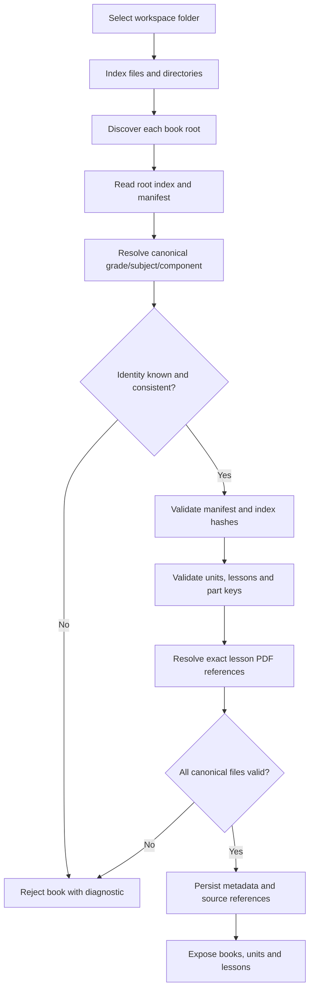

# Workspace Binding and Import Contract

## 1. Responsibility boundary

Indexer2 prepares and exports the workspace. Edu Mini imports or directly binds that prepared workspace.

Edu Mini must not:

- rerun PDF discovery or AI index extraction;
- regenerate unit/lesson structure from the PDF;
- re-slice the source PDF;
- invent grade, subject, component, unit, lesson, part, or page values;
- modify the source `index.json`, `book_manifest.json`, or lesson PDFs during binding.

The binder validates the package, stores metadata and file references, and keeps source assets at their selected location.

## 2. Supported book root

The canonical book root is:

`workspace/<gradeKey>/<subjectKey>[/<componentKey>]/`

The book root contains the root `index.json` and `book_manifest.json`. The path identifies the curriculum grouping; the JSON files confirm the identity and source metadata.

A grade workspace can contain multiple subject books and component books. Each paired root index and manifest belongs to one book root. The importer must not select the first `index.json` under a grade as if it represented all books.

## 3. Identity validation

Before binding a book:

1. Parse the root `index.json`.
2. Parse `book_manifest.json`.
3. Resolve grade, subject, and optional component from the canonical path and declared identity fields.
4. Require a recognized grade key from G01–G12.
5. Require a recognized `subjectKey`.
6. Validate optional `componentKey` against the canonical catalog and its parent subject.
7. Verify path and metadata identity agree.
8. Verify index/manifest identity and source integrity fields required by the canonical contract.
9. Validate units, lessons, part assignments, page ranges, and referenced PDF files.

A missing or unknown `subjectKey` is a blocking identity error. The binder must not use a generic subject label or infer a key from a book title. A missing grade is also blocking; no default grade is permitted.

The canonical display names are obtained from `BookMetadataMapper`. Names declared in index/manifest are not allowed to replace canonical key-to-label mappings.

## 4. Manifest and index integrity

For canonical Indexer2 exports:

- `book_manifest.json` declares `manifestVersion=edu.book_manifest.v1`.
- `sourceSha256` identifies the original PDF bytes.
- `indexSha256` identifies the serialized root `index.json`.
- The manifest and index must agree on grade and subject.
- The canonical validator checks the index hash and source review/approval requirements.
- A canonical index must contain units and lessons with stable source identity and valid page ranges.
- Canonical units must be assigned to P01 or P02 before binding.

The current Android validator also checks that each expected lesson PDF can be resolved and that canonical lesson PDFs are readable as PDF files.

## 5. Lesson file resolution

The binder resolves a lesson file using the explicit lesson reference first. In particular, `sliceFile.workspaceUri` is the preferred reference. It then considers the other explicit file-reference fields supported by the validator and finally the known canonical path candidates.

A file must match the lesson's own unit and part. If a canonical lesson file is missing or unreadable, the book is rejected with a diagnostic. The binder must not substitute a different lesson PDF.

## 6. Part indexes

For a merged book:

- Root `index.json` remains canonical.
- `P01/index.json` and `P02/index.json` are optional derived views.
- Derived views must not be used as a replacement for the root index.
- A part directory/index is expected only when units are assigned to that part.
- The unit's own `partKey` controls its part placement.

For a single-part source, the root index remains canonical and its units carry the corresponding P01 or P02 assignment.

## 7. Unit and lesson identifiers

The Indexer2 template model carries source unit and lesson numbers. The Android validator derives stable keys from those numbers when explicit keys are absent:

- `unit_01`, `unit_02`, and so on;
- `lesson_01`, `lesson_02`, and so on.

When the same unit number exists in both parts, the application key includes the part to avoid collision. The folder key used for the unit PDF directory remains the canonical padded unit-number form.

Array position is never the canonical identity. Reordering a JSON array must not silently change a unit or lesson's identity.

## 8. Binding sequence

## 9. Persistence boundary

The direct binder stores workspace metadata and references in the application database. Source PDFs and workspace JSON files remain in the selected workspace. Generated educational content is a separate application-owned data concern and must not be written into canonical source files as a side effect of binding.

## 10. Rejection diagnostics

A rejected book should identify the failing book root and the specific field or file:

- unknown or missing `gradeKey`;
- unknown or missing `subjectKey`;
- unknown or incompatible `componentKey`;
- path/metadata identity mismatch;
- malformed JSON;
- manifest/index hash mismatch;
- unapproved source or index;
- unresolved unit part;
- missing stable unit/lesson identity;
- invalid page range;
- missing or unreadable lesson PDF.

A rejection must not be repaired by a guessed key, a default grade, a display-name substitution, or a different lesson file.
