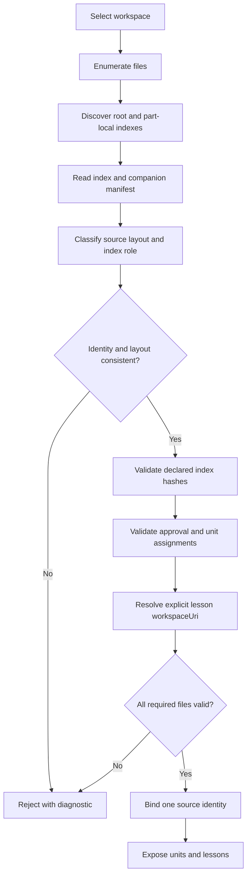

# Workspace Binding and Import Contract

## 1. Responsibility boundary

**Indexer2 is the workspace producer and the single source of truth for book structure. Edu Mini is a workspace consumer.**

Indexer2 is responsible for:
- identifying grade, subject, optional component, source layout and part assignment;
- reviewing and approving the index and page calibration;
- slicing lesson PDFs;
- writing every index, manifest, validation artifact and lesson-file reference;
- recording hashes and review provenance.

Edu Mini must not repeat PDF discovery, AI index extraction, part classification, unit assignment, page calibration or lesson slicing. It must not reconstruct lesson paths when the index already provides a valid `sliceFile.workspaceUri`.

Edu Mini validates the package, reads the prepared index records, resolves their declared file references, and persists application metadata/references. It does not rewrite source artifacts.

## 2. Workspace root and index placement

The logical curriculum root is:

`workspace/<gradeKey>/<subjectKey>[/<componentKey>]/`

The placement of `index.json` depends on the verified source layout. The path alone does not change source identity.

### 2.1 Independent single-part PDF

An independent PDF contains one part only. Its index and companion manifest live inside that part directory:

```text
workspace/G07/ENG/COURSE/
  P01/
    index.json
    book_manifest.json
    cover.png
    units/...
```

For a P02 source, use `P02/index.json` and `P02/book_manifest.json`. Do not require or synthesize a root `index.json` for this layout. Each independent PDF has its own source SHA-256 and source identity.

### 2.2 One merged PDF containing both parts

A merged PDF is one source and one logical book identity. Its root index is canonical; part indexes are filtered views, not separate books:

```text
workspace/G07/ENG/COURSE/
  index.json
  book_manifest.json
  cover.png
  P01/
    index.json
    cover.png
    units/...
  P02/
    index.json
    cover.png
    units/...
```

The root index contains the complete unit list. Each part index contains only units assigned to that part. Edu Mini binds the root index once and must not create duplicate books from its derived part indexes.

### 2.3 Merged PDF with unresolved unit assignments

The source remains `MERGED_PARTS_FILE`. An unclear TOC does not convert it into a single-part PDF.

The root index and manifest remain review artifacts. For an unresolved unit:
- keep the actual `partKey` unresolved;
- an optional `proposedPartKey=P01` is only a proposal;
- record `assignmentStatus=NEEDS_REVIEW` and the proposal/evidence source;
- do not export an approved part index for that unresolved unit;
- do not slice or mark the source approved until a reviewer explicitly confirms or changes the assignment.

A P01 proposal must never be silently promoted to a confirmed assignment.

## 3. Identity and display metadata

The canonical identity fields are `gradeKey`, `subjectKey`, and optional `componentKey`. They are validated against the Indexer2 key catalog and the workspace path.

Display labels are presentation data:
- use a non-empty `displayName` / `subjectName` / `componentName` declared by the prepared index when available;
- otherwise use the Android catalog as a fallback;
- never use a display label to derive or replace a canonical key.

The same rule applies to grade labels. Unknown or inconsistent canonical keys remain blocking errors; a display string cannot repair them.

## 4. Discovering workspaces

The binder/importer must discover both supported index locations:
- root index: `<bookRoot>/index.json`;
- part index: `<bookRoot>/P01/index.json` or `<bookRoot>/P02/index.json`.

Classification is based on the index and companion manifest fields, not folder name alone:
- `sourceLayout=SINGLE_PART_FILE` plus a part-local index/manifest is one independent source;
- `sourceLayout=MERGED_PARTS_FILE` plus a root index/manifest is one merged source;
- a merged part-local index is a derived view and must be associated with its root merged source, never imported as an independent source.

Reject ambiguous or contradictory combinations rather than guessing.

## 5. Index and manifest integrity

The manifest must identify the source PDF using `sourceSha256`. Hashes identify exact serialized index bytes:
- independent part: the part-local `index.json` hash;
- merged source: the root `index.json` hash, plus hashes for each exported part view when present.

The exporter must declare the exact relative index paths and hashes in the manifest. The consumer verifies every declared file against its own hash. It must not compare a part index with the root index hash.

For backward compatibility, the consumer may read the legacy root-index manifest contract when its fields and hash validate. Compatibility must not weaken validation of new packages.

## 6. Lesson file resolution

Resolve lesson PDFs in this order:
1. the lesson's explicit `sliceFile.workspaceUri` relative to the workspace root (or a supported workspace URI form);
2. another explicit relative file path only if the Indexer2 schema declares it;
3. legacy path reconstruction only for older workspaces that lack a usable explicit reference.

Normalize and validate paths to prevent traversal outside the selected workspace. Confirm the referenced file exists, is readable as a PDF, and belongs to the lesson record being imported. Do not substitute another lesson file.

Do not infer the PDF path from unit number, lesson number, or part folder when a valid `workspaceUri` exists.

## 7. Unit and lesson identity

Use stable unit/lesson identifiers from the index when present. Otherwise derive compatibility keys from source numbers, including the part context where duplicate unit numbers can occur in a merged source.

Array order is not identity. A part view is not a second book identity. Duplicate source unit numbers across P01/P02 are valid only when their source identifiers and part context distinguish them.

## 8. Binding sequence



## 9. Current implementation status versus target contract

The Android implementation has now been updated toward this contract:
- the direct binder discovers root and part-local indexes; a part-local index is accepted as an independent source only with its local manifest, while a merged derived view is skipped when its root index exists;
- the ZIP importer applies the same rule and keeps the P01/P02 suffix in the independent source identity without treating it as a component key;
- the validator checks the canonical index hash/path and verifies every declared merged part-index path and SHA-256;
- a declared `sliceFile.workspaceUri` is authoritative. If it is unsafe or cannot be resolved, the consumer does not silently reconstruct a different lesson path; legacy reconstruction is reserved for packages with no explicit URI;
- the importer and binder prefer the index-provided `subjectName` for display, with the Android mapper as fallback.

Tests have been added for standalone part-local import/binding, merged derived-index hash validation, and explicit URI precedence. The repository test suite and Android build have not been run in this work session; the GitHub commits currently show no CI status checks. Do not treat code changes as test-passing until those commands run successfully.

## 10. Rejection diagnostics

Report the book root, index path and failing field/file. At minimum distinguish:
- missing or invalid grade/subject/component key;
- path/metadata identity mismatch;
- unsupported source-layout/index-placement combination;
- missing or invalid manifest;
- root or part index hash mismatch;
- unapproved source or unresolved unit assignment;
- duplicate unit/lesson identity;
- unsafe, missing, unreadable or mismatched lesson PDF reference.

Never repair a failed package by guessing a grade, subject, part, title, page range or file path.
