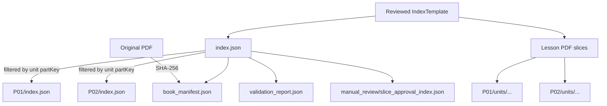

# Workspace Index Schema and Structural Diagrams

## 1. Canonical workspace root

Indexer2 exports each book under:

```text
workspace/
└── <gradeKey>/
    └── <subjectKey>/
        └── [<componentKey>/]
            ├── index.json
            ├── book_manifest.json
            ├── cover.png
            ├── validation_report.json
            ├── manual_review/
            │   └── slice_approval_index.json
            ├── P01/
            │   ├── index.json        # merged source only; derived view
            │   └── units/
            │       └── <unit-folder>/
            │           └── lesson_<nn>.pdf
            └── P02/
                ├── index.json        # merged source only; derived view
                └── units/
                    └── <unit-folder>/
                        └── lesson_<nn>.pdf
```

The optional component directory is present only when the template has a component key. The exporter writes the canonical root `index.json` and `book_manifest.json` at the book root.

## 2. Authority and relationships



Authority rules:

1. Root `index.json` is the canonical lesson/unit index.
2. `book_manifest.json` is the companion source/identity/export manifest.
3. `P01/index.json` and `P02/index.json` are derived filtered views for merged books.
4. Lesson PDFs are files referenced by the canonical lesson metadata and/or the known workspace path contract.
5. Validation and approval files provide evidence; they do not replace the index or source PDF.

## 3. Canonical identity tuple

A book's workspace identity is represented by:

`gradeKey + subjectKey + optional componentKey`

Example:

`G07 / ENG / COURSE`

The part is not a substitute for subject identity. `partKey` describes whether a template represents P01, P02, or a merged BOTH source. For merged sources, every unit has its own P01/P02 assignment.

## 4. Root index structure

The root `index.json` is serialized from the Indexer2 `IndexTemplate` object. The TypeScript interface defines these fields:

### 4.1 Book-level fields

| Field | Type | Contract |
|---|---|---|
| `templateId` | string | Template contract identifier |
| `templateName` | string | Canonical template filename with JSON extension |
| `title` | string | Book title |
| `displayName` | string | Human-readable book title |
| `gradeKey` | string | Canonical grade key |
| `subjectKey` | string | Canonical subject key |
| `componentKey` | string or null | Optional canonical component key |
| `partKey` | P01 / P02 / BOTH / unknown | Template-level part state |
| `offset` | number | Printed-to-physical page offset used by current slicer |
| `coverPdfPage` | number | Physical page used as cover |
| `expectedPdfPages` | number or null | Optional expected source page count |
| `sourceMetadata` | object | Evidence and source metadata |
| `units` | array | Ordered unit records |
| `sourceLayout` | enum | UNKNOWN_REVIEW / MERGED_PARTS_FILE / SINGLE_PART_FILE |
| `sourceReviewStatus` | enum | NEEDS_REVIEW / VERIFIED / REJECTED |
| `approvalStatus` | enum | PENDING / APPROVED / REJECTED |
| `requiresReview` | boolean | Whether review remains required |

Other optional interface fields include description, reviewReason, reviewerName, approvalReason, approvedAt, published, publishedAt, createdAt, totalPdfPages, fileName, workspaceRelPath, and profileId.

## 5. Unit and lesson structure

### 5.1 Unit

A unit contains:

| Field | Type | Meaning |
|---|---|---|
| `unitNumber` | number | Source unit number |
| `title` | string | Unit title |
| `unitPrintedPage` | number? | Printed page of unit heading |
| `unitPdfPage` | number? | Physical PDF page when populated |
| `partKey` | P01 / P02 / BOTH / unknown | Unit's own part assignment |
| `lessons` | array | Lessons in source order |
| `unitReview` | object or null | Optional unit assessment page range |

The slicing gate requires each sliced unit to have `partKey=P01` or `partKey=P02`.

### 5.2 Lesson

The `Lesson` interface defines:

| Field | Type | Meaning |
|---|---|---|
| `lessonNumber` | number | Lesson number within its unit |
| `title` | string | Lesson title |
| `contentType` | string? | Content classification |
| `printedPageStart`, `printedPageEnd` | number | Printed page range |
| `pdfPageStart`, `pdfPageEnd` | number? | Optional physical PDF page metadata |
| `summary` | string? | Optional summary |
| `keyConcepts` | string[]? | Optional concepts |
| `sliceFile` | object? | Generated lesson file reference |
| `requiresReview`, `reviewReason` | optional | Lesson review state |

`sliceFile` is a `LessonSliceLink` with `workspaceUri`, `fileName`, optional `fileSha256`, `byteSize`, `extractedText`, `isAvailable`, `isAnalyzed`, `analyzedAt`, and `chunksCount`.

Important: the current slicer calculates the actual cut using `printedPageStart + offset` and `printedPageEnd + offset`. The optional `pdfPageStart` / `pdfPageEnd` fields are not the current slicer's input.

## 6. Manifest structure

The current `downloadPythonWorkspaceZip` exporter writes `book_manifest.json` with:

| Field | Type | Meaning |
|---|---|---|
| `manifestVersion` | string | `edu.book_manifest.v1` |
| `bookTitle` | string | Template title |
| `gradeKey` | string | Canonical grade |
| `subjectKey` | string | Canonical subject |
| `componentKey` | string or null | Optional component |
| `partKey` | string | Template-level part |
| `sourceLayout` | string | Source layout |
| `sourceReviewStatus` | string | Review state |
| `sourceFileName` | string | Original PDF name |
| `sourceSha256` | string | Original PDF SHA-256 |
| `indexSha256` | string | Root index SHA-256 |
| `totalLessons` | number | Exported lesson count |
| `unitsCount` | number | Unit count |
| `offset` | number | Slicing offset |
| `coverImagePaths` | string[] | Cover paths |
| `partIndexPaths` | string[] | Derived part-index paths |
| `createdAt` | ISO timestamp | Export time |

The manifest is written by the exporter. Fields not listed above must not be assumed to exist in this exporter output.

## 7. Identifier derivation

Indexer2's template interfaces identify units and lessons by their source numbers. The Android contract validator derives stable application keys when explicit keys are absent:

- Unit: `unit_<two-digit unitNumber>`
- Lesson: `lesson_<two-digit lessonNumber>`
- For repeated unit numbers in different parts, the validator includes the part in the unit key (for example, `P01_unit_01` and `P02_unit_01`) while preserving the unit folder key used by the PDF path.

An explicit stable key in an index takes precedence where the validator supports it. Array position is not a replacement for source numbering.

## 8. Page-number semantics

- `printedPageStart` and `printedPageEnd` refer to the printed numbering in the textbook.
- The physical PDF page is the one-based page index in the source PDF file.
- The current slicer derives physical pages using the template `offset`.
- `pdfPageStart` and `pdfPageEnd` are optional metadata in the interface; they do not override the current slicer calculation.

Never add an offset twice. Never use printed page numbers directly as physical PDF page numbers without applying the reviewed mapping.

## 9. Canonical invariants

- Every book root has one canonical root `index.json`.
- The root index and manifest describe the same grade, subject, component, part, and source.
- A merged book may have derived part indexes; these are not independent source-of-truth files.
- Each lesson PDF belongs to exactly one unit and one part.
- A missing lesson PDF is a binding/validation error; do not substitute another lesson's file.
- A page range outside the source PDF is a slicing error and must be reviewed.
